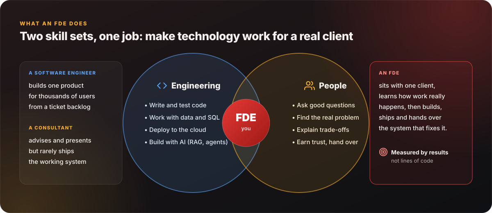
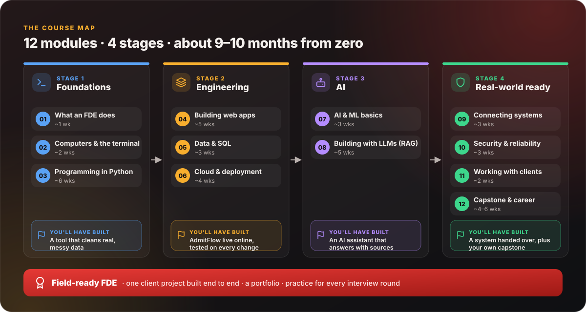
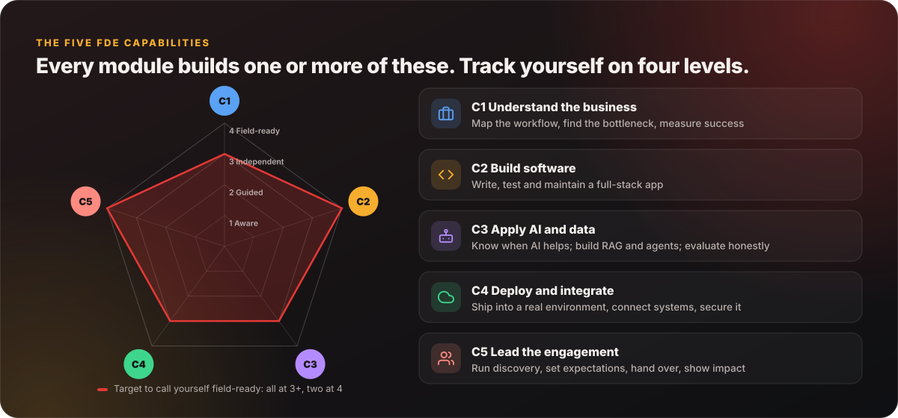

# Forward Deployed Engineering (FDE) Handbook

### The Complete, Production-Grade Path from Zero to Enterprise AI Solutions Architect

[-821713?style=flat-square)](projects/admitflow/README.md)

 

**[📖 Read Online (Interactive Web App)](https://abvicky.github.io/FDE-Handbook-by-Vicky/)** &nbsp;•&nbsp;
**[🚀 Start Here](START-HERE.md)** &nbsp;•&nbsp;
**[🗺️ Full Roadmap](ROADMAP.md)** &nbsp;•&nbsp;
**[🎯 Interview Prep Suite](interview-prep/README.md)** &nbsp;•&nbsp;
**[ℹ️ About & Author](ABOUT.md)**

 

> [!TIP]
> **Experience the Interactive Web Application:** Read this entire handbook with instant fuzzy search (`⌘K`), dark and light cinematic themes, interactive data pipeline visualizers, and an FDE competency radar chart at **[abvicky.github.io/FDE-Handbook-by-Vicky](https://abvicky.github.io/FDE-Handbook-by-Vicky/)**.

---

## Executive Summary

The **Forward Deployed Engineering (FDE) Handbook** is an open-source, comprehensive engineering curriculum designed to take you from first principles to field-ready deployment. 

Unlike traditional software engineering courses that focus solely on isolated syntax, or business bootcamps that stop at slide decks, this handbook bridges the critical divide: **deep technical engineering** coupled with **high-stakes, client-facing system delivery**.

Throughout the 12 modules, you do not write toy scripts. You build **AdmitFlow**—a complete, production-grade enterprise admissions and lead-intelligence platform for a client from scratch: from raw CLI parsers and SQLite databases to FastAPI microservices, retrieval-augmented generation (RAG), AI scoring agents, OAuth2 security, and multi-tenant Docker deployments.

---

## What is a Forward Deployed Engineer?

In one sentence: **An engineer who deploys directly to where the client's problem is, uncovers the truth of the workflow, and architects, codes, and ships the software and AI that solves it.**

Originally pioneered and popularized by companies like **Palantir**, the Forward Deployed Engineer role has become the most sought-after engineering discipline of the AI era. Companies do not just need model weights; they need engineers who can integrate complex AI into messy enterprise realities.

| Dimension | 💻 Traditional Software Engineer | 🤝 Solutions / Sales Engineer | ⚡ Forward Deployed Engineer (FDE) |
| :--- | :--- | :--- | :--- |
| **Primary Focus** | Internal products for millions of anonymous users | Pre-sales demos, slide decks, and product configuration | Production system delivery & custom business logic |
| **Working Environment** | Internal engineering teams & backlogs | Sales meetings & conference calls | Client environment, production databases, real users |
| **Technical Depth** | High (core infrastructure & features) | Medium (scripts, demos, API samples) | **Full-Stack & Deep** (FastAPI, React, SQL, Cloud, AI/RAG) |
| **Problem Definition** | Given by product managers (Jira tickets) | Defined by RFP requirements | **Uncovered on the ground** by listening to users |
| **Key Metric** | Story points, uptime, sprint velocity | Closed revenue, deal velocity | **Actual user adoption & measurable business impact** |

---

## The Running Story: One Production Project (AdmitFlow)

Instead of disconnected, throwaway exercises, every module in this handbook builds upon a single running enterprise project:

```mermaid
flowchart LR
    subgraph S1["1. Multi-Channel Ingestion"]
        direction TB
        W1["Web Inquiry Forms"]
        W2["Paid Ads (Meta/Google)"]
        W3["WhatsApp Business API"]
        W4["Walk-in CSV Exports"]
    end

    subgraph S2["2. AdmitFlow Core Platform"]
        direction TB
        C1["FastAPI Ingestion Engine"]
        C2["Deduplication & Normalization"]
        C3[("PostgreSQL / SQLite Storage")]
        C4["Immutable Audit Logging"]
    end

    subgraph S3["3. Applied AI & RAG Engine"]
        direction TB
        A1[("Vector Embeddings (pgvector)")]
        A2["Hybrid Knowledge Retriever"]
        A3["LLM Intent & Lead Scorer"]
        A4["Automated Follow-up Drafter"]
    end

    subgraph S4["4. Enterprise Delivery & Operations"]
        direction TB
        D1["React Counsellor Dashboard"]
        D2["Model Context Protocol (MCP)"]
        D3["Docker / Cloud Run Deploy"]
        D4["Prometheus & OpenTelemetry"]
    end

    S1 -->|"Raw Webhooks & Batches"| S2
    S2 <-->|"Embeddings & Context"| S3
    S2 -->|"Authenticated APIs"| S4
```

> **Client Scenario:** **Northbridge Institute** receives thousands of admissions inquiries each month across web forms, ads, walk-ins, and WhatsApp. Leads sit untouched in disconnected spreadsheets, counsellors waste hours on repetitive questions, and qualified applicants drop out. The director asks for *"an AI chatbot."* 
> 
> As an FDE, you discover that what they actually need is an **integrated data pipeline, automated lead scorer, and RAG-powered course assistant** that counsellors trust. You design and build **AdmitFlow** from first principles to full production handover.

---

## The Path: 12 Modules, 4 Stages

Each stage develops a specific pillar of your engineering and client capabilities:

### Stage 1: Foundations (The Craft, The Machine, & Code)
*Target: From first concepts to writing production-ready, test-driven Python code.*

| Module | Title & Focus | Key Technical & Client Skills | AdmitFlow Milestone |
| :---: | :--- | :--- | :--- |
| **01** | **[What an FDE Does](modules/01-introduction-to-fde/README.md)** | Discovery interviews, stakeholder mapping, identifying last-mile problems | Discovery brief & client problem framing |
| **02** | **[Computing Foundations](modules/02-computing-foundations/README.md)** | UNIX terminal, shell pipelines, TCP/IP, DNS, HTTP/HTTPS fundamentals | Automated lead file processor via shell script |
| **03** | **[Programming Fundamentals](modules/03-programming-fundamentals/README.md)** | Python 3, object-oriented design, error handling, `pytest`, static typing | Ingestion pipeline CLI & data normalizer |

### Stage 2: Engineering (Web Architecture, Data, & Infrastructure)
*Target: Architecting full-stack web applications, relational databases, and containerized cloud services.*

| Module | Title & Focus | Key Technical & Client Skills | AdmitFlow Milestone |
| :---: | :--- | :--- | :--- |
| **04** | **[Software Engineering](modules/04-software-engineering/README.md)** | FastAPI backend, React/TypeScript UI, token-based authentication (JWT) | AdmitFlow REST API & Counsellor Web UI |
| **05** | **[Databases & Data Engineering](modules/05-databases-and-data-engineering/README.md)** | PostgreSQL, SQLite, schema normalization, Alembic migrations, deduplication | Robust database repository & deduplication engine |
| **06** | **[Cloud & Infrastructure](modules/06-cloud-and-infrastructure/README.md)** | Docker multi-stage builds, Docker Compose, CI/CD with GitHub Actions | Containerized stack & automated CI test harness |

### Stage 3: Applied AI (Machine Learning, RAG, & Agentic Systems)
*Target: Moving past toy prompts to build evaluation-backed, grounded AI systems that operate safely in production.*

| Module | Title & Focus | Key Technical & Client Skills | AdmitFlow Milestone |
| :---: | :--- | :--- | :--- |
| **07** | **[AI & Machine Learning](modules/07-ai-and-machine-learning/README.md)** | Supervised learning, classification, evaluation metrics (precision/recall), scikit-learn | Machine-learned conversion likelihood scorer |
| **08** | **[Generative AI Engineering](modules/08-generative-ai-engineering/README.md)** | RAG pipelines, chunking strategies, vector embeddings, prompt engineering, evals | Course Assistant RAG & automated drafting agent |

### Stage 4: Real-World Ready (Integration, Security, Client Leadership, & Career)
*Target: Integrating with enterprise legacy systems, bulletproofing reliability, and landing high-paying FDE roles.*

| Module | Title & Focus | Key Technical & Client Skills | AdmitFlow Milestone |
| :---: | :--- | :--- | :--- |
| **09** | **[Enterprise Integration](modules/09-enterprise-integration/README.md)** | Webhooks, OAuth2, CRM sync, rate limits, Model Context Protocol (MCP) | WhatsApp webhook adapter & CRM sync |
| **10** | **[Production Security & Reliability](modules/10-production-security-reliability/README.md)** | OWASP Top 10, prompt injection defence, PII redacting, logging & alerts | Production hardening, audit trail, & health alerts |
| **11** | **[Business & Client Engineering](modules/11-business-and-client-engineering/README.md)** | Business case & ROI modeling, scoping, change management, client handover | Executive business case & deployment runbook |
| **12** | **[Capstone & Career Strategy](modules/12-capstone-and-career/README.md)** | Independent capstone architecture, portfolio positioning, interview prep | Full end-to-end portfolio presentation |

---

## The 5 Core FDE Competencies (C1–C5)

Every module builds one or more of these five capabilities, and you track yourself on four levels (1 Aware · 2 Guided · 3 Independent · 4 Field-ready) in [your self-assessment](progress/self-assessment.md).

1. **C1 — Understand the business:** map a workflow, find the bottleneck, put a cost on it, and define what success looks like.
2. **C2 — Build software:** write, test, debug and maintain a full-stack application.
3. **C3 — Apply AI and data:** decide when AI helps (and when it doesn't), build RAG and agents, and evaluate them honestly.
4. **C4 — Deploy and integrate:** ship into a real environment, connect to existing systems, and secure and monitor it.
5. **C5 — Lead the engagement:** run discovery, manage expectations, explain trade-offs, hand over, and measure impact.

---

## Comprehensive Interview Preparation Suite

Preparing for FDE interviews requires far more than generic LeetCode grinding. We provide dedicated interview prep tracks with real questions, evaluation rubrics, and model solutions:

* **[Interview Prep Overview](interview-prep/README.md):** Demystifying the FDE hiring pipeline and how hiring managers evaluate candidates.
* **[Coding Round](interview-prep/coding.md):** Practical data wrangling, API handlers, and clean systems programming (with [Python solutions](interview-prep/solutions/coding_solutions.py)).
* **[System Design Round](interview-prep/system-design.md):** Designing resilient data pipelines, multi-tenant AI systems, and offline-tolerant enterprise architectures.
* **[Live Debugging & Incident Response](interview-prep/debugging.md):** Step-by-step troubleshooting of real-world production outages, latency spikes, and corrupt data.
* **[Client Scenarios & Discovery](interview-prep/client-scenarios.md):** Realistic roleplays with difficult clients, budget constraints, and scoping negotiations.
* **[Take-Home Assignment](interview-prep/take-home.md):** Guidance on structuring, documenting, and defending a production-quality take-home project.
* **[Behavioural & Leadership](interview-prep/behavioural.md):** High-impact framing for ownership, client conflict, ethical AI, and cross-functional leadership.

---

## What Makes This Platform Special

The companion reading web app ([abvicky.github.io/FDE-Handbook-by-Vicky](https://abvicky.github.io/FDE-Handbook-by-Vicky/)) was engineered from the ground up to provide a distraction-free, lightning-fast learning environment:

* 🔎 **Instant Client-Side Fuzzy Search (`⌘K`):** Search instantly across all 421 documents, exercises, and code files with zero network latency.
* 🌗 **High-Contrast Cinematic Theme:** Engineered with crisp light and dark modes utilizing deep crimson (`#A31C18`), emerald (`#218354`), and charcoal backgrounds tested for WCAG AAA accessibility.
* 📊 **Interactive Competency Radar:** Measure your real-time skill scorecards across C1–C5 as you check off module exercises.
* 🔄 **Live Pipeline Visualizer:** Interactive data-flow diagram simulating the movement of customer leads through AdmitFlow's architecture.
* 📦 **100% Offline & Local-First:** Zero trackers, zero cookies, zero external framework bloat. Your progress is persisted securely in your browser's local storage.
* 📱 **Fully Responsive:** Optimized reading experience across mobile phones, tablets, and wide-screen desktop monitors.

---

## Getting Started

You do not need to read everything in one sitting. Follow these three steps:

1. **Read [START-HERE.md](START-HERE.md):** A concise, 5-minute guide that helps you diagnose your starting point and select the right study path.
2. **Open [Module 01: What an FDE Does](modules/01-introduction-to-fde/README.md):** Begin the first lesson with zero software installation required.
3. **Track Your Milestones:** Duplicate the [Progress Self-Assessment Checklist](progress/self-assessment.md) and check off your skills as you complete them.

---

## Meet the Author

<table>
  <tr>
    <td width="120" align="center" valign="top">
      
        
      
       
      
       
      
    </td>
    <td valign="top">
      <h3>Vicky Prasad Mahato</h3>
      
<strong>Author · System Architect · Digital Product Builder</strong>

      

        Vicky Prasad Mahato (known online as <strong>abvicky</strong>) is a system architect and software engineer based in Kolkata, India. He builds resilient digital systems and software tools, with a dedicated focus on offline-first architectures, data sovereignty, and applied artificial intelligence.
      

      

        As the founder of the <strong>Coders' Club at BBIT Kolkata</strong> and former student coordinator at the Innovation and Incubation Center (IIC) and Entrepreneurship Development Cell (EDC), Vicky has mentored hundreds of aspiring engineers in software design, problem solving, and modern development practices. He is also the creator of open-source projects including <em>Mera Paisaa</em>, an offline-first personal financial management system.
      

      <blockquote>
        <em>"Forward Deployed Engineering is not about memorizing syntax or chasing frameworks. It is the high-velocity discipline of stepping directly into a client's messy reality, understanding their fundamental business problem, and shipping resilient, production-ready systems that create undeniable value."</em>
      </blockquote>
    </td>
  </tr>
</table>

---

## Platform & Technical Infrastructure

<table>
  <tr>
    <td width="120" align="center" valign="top">
      
        
      
    </td>
    <td valign="top">
      <h3>Manikarnika Technologies</h3>
      
<strong>Platform Architecture, Design System & Digital Infrastructure</strong>

      

        The custom reading platform, interactive design system, live competency radar engine, client-side search indexing, and responsive web components were designed and engineered by <strong>Manikarnika Technologies</strong>.
      

      

        Manikarnika Technologies builds high-performance, distraction-free educational platforms, developer tooling, and modern digital infrastructure. The platform was created from the ground up without heavy external frameworks, providing instantaneous page loads, zero runtime bloat, 100% offline capability, and complete privacy for learners worldwide.
      

    </td>
  </tr>
</table>

---

## Contributing & Community

We actively welcome contributions from the community! Whether you want to fix a typo, suggest a real-world case study, or submit a new exercise:
- Please review our **[Contributing Guidelines](CONTRIBUTING.md)** for detailed instructions.
- All participants are expected to adhere to our **[Code of Conduct](CODE_OF_CONDUCT.md)**.
- For security vulnerabilities, please consult our **[Security Policy](SECURITY.md)**.

---

## Copyright & Terms of Use

© 2026 **[Manikarnika Technologies](https://www.manikarnikatechnologies.in/)** and **[Vicky Prasad Mahato](https://abvicky.in)**. **All Rights Reserved.**

* **Author:** **[Vicky Prasad Mahato](https://abvicky.in)** ([LinkedIn](https://www.linkedin.com/in/abvicky/) · [GitHub](https://github.com/ABVicky))
* **Platform Architecture & Development:** **[Manikarnika Technologies](https://www.manikarnikatechnologies.in/)**
* **License & Terms:** See **[LICENSE](LICENSE)** for complete terms.

This repository is publicly accessible on GitHub for **viewing, reading, study, and educational inspection only**. All rights to the original source code, scripts, software architecture, curriculum structure, lessons, exercises, reference application (AdmitFlow), case studies, and instructional designs are reserved by the copyright owners.

Without prior written permission from the copyright owners, nobody is permitted to:
- **Copy or redistribute** the source code, curriculum, or materials in whole or in part.
- **Re-upload or republish** the code, reader platform, AdmitFlow reference system, or content in another repository or platform.
- **Claim the original code or content** as their own.
- **Modify and distribute** derivative versions or adaptations of this work.
- **Use the code or curriculum commercially** (including paid courses, bootcamps, client work, or books).
- **Reuse substantial portions** of the code, reference application, or reader architecture in other projects.
- **AI Training & Dataset Extraction:** Ingest, scrape, or extract this curriculum, code, or documentation for training, fine-tuning, or evaluating commercial AI models or proprietary machine learning datasets without explicit prior authorization.

For complete license terms, restrictions, permissions, and third-party dependency notices, please see the full **[LICENSE](LICENSE)** file.
