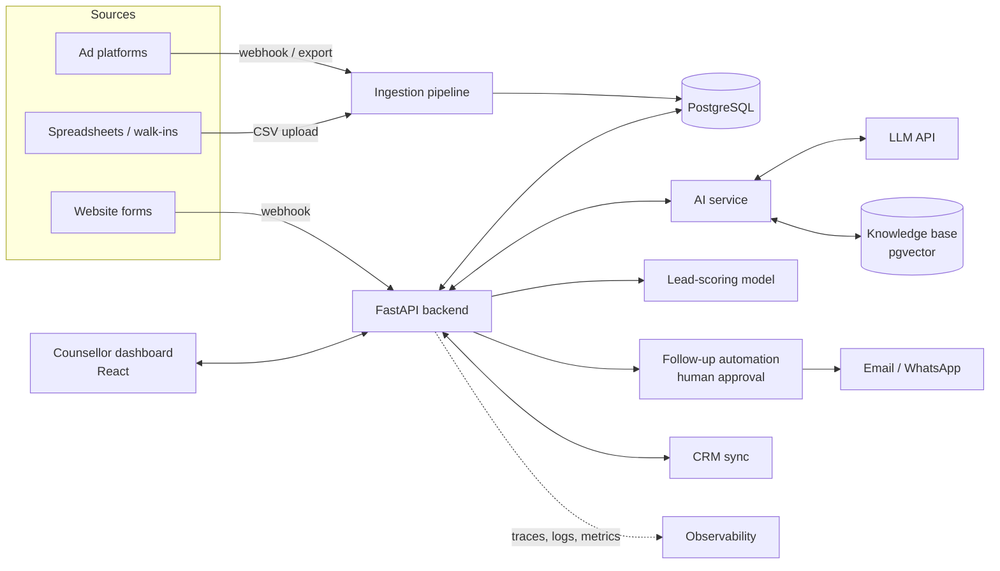
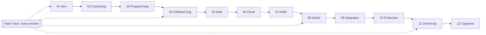
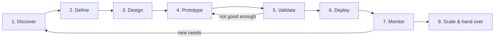

# FDE Handbook by Vicky — Master Roadmap

> A learning path from **zero** to **professional Forward Deployed Engineer (FDE)**.
> Theory + technology + field practice, built around one real business problem you solve end to end.

> **New here? You don't need to read this page.** It's the full plan behind the handbook: how I designed it, what every module covers, and how you're assessed. It's useful later, or if you're curious. If you just want to start learning, go to **[Start Here](START-HERE.md)**, then **[Module 01](modules/01-introduction-to-fde/README.md)**.

---

## Contents

1. [Who this is for and where to start](#1-who-this-is-for-and-where-to-start)
2. [What an FDE is (and is not)](#2-what-an-fde-is-and-is-not)
3. [The competency model](#3-the-competency-model)
4. [How the curriculum is designed](#4-how-the-curriculum-is-designed)
5. [The running project: AdmitFlow](#5-the-running-project-admitflow)
6. [Curriculum at a glance](#6-curriculum-at-a-glance)
7. [Modules in detail](#7-modules-in-detail)
8. [The FDE engagement lifecycle](#8-the-fde-engagement-lifecycle)
9. [Projects and capstones](#9-projects-and-capstones)
10. [The FDE documentation kit](#10-the-fde-documentation-kit)
11. [Assessment: how you know you are ready](#11-assessment-how-you-know-you-are-ready)
12. [Timeline and pacing](#12-timeline-and-pacing)
13. [Specialization tracks](#13-specialization-tracks)
14. [Technology stack: core vs. optional](#14-technology-stack-core-vs-optional)
15. [Repository structure](#15-repository-structure)
16. [Build plan for this repository](#16-build-plan-for-this-repository)
17. [References](#17-references)

---

## 1. Who this is for and where to start

The goal: someone who understands neither FDE nor enterprise technology can finish this path able to **find a business problem, engineer a solution, deploy it into a real environment, and own the outcome with the client.**

| You are… | Start at | You can skip / skim |
| --- | --- | --- |
| **Complete beginner** (basic computer use) | Module 01 | Nothing — follow the full path |
| **Student / junior developer** (some Python or JS) | Module 01, then take the Module 02–03 checkpoint quizzes | Modules 02–03 if you pass the checkpoints |
| **Working software engineer** | Module 01 → 05 checkpoint → 06 | Most of 02–05; focus on 07–11 and the Field Track |
| **Data / ML engineer** | Module 01 → 04 → 08 | 05, 07 (skim) |
| **Consultant / solutions engineer / PM** (business-strong, code-light) | Module 01, then 02–04 in full | Parts of 11 you already practise |

Every module opens with a **checkpoint quiz**. Pass it (≥ 80%) and complete its build task, and you may move on.

**What this roadmap does not promise:** a job. It focuses on skills you can *demonstrate* — a deployed system, documented decisions, and a client-style presentation.

---

## 2. What an FDE is (and is not)

A **Forward Deployed Engineer** is a software engineer who works *inside* a customer's world — their data, systems, constraints and people — and builds the solution that makes a product or technology actually deliver value there.

### Why the role exists

Companies buying advanced software (especially AI) hit the same wall:

- Data is spread across systems that don't talk to each other.
- Legacy software doesn't integrate easily with modern tools.
- Security, privacy and compliance rules limit what can be deployed.
- Departments have different workflows and different definitions of success.
- Nobody knows yet which solution will actually work.
- A prototype that works in a demo fails on real data, real users and real scale.

A product alone rarely closes this gap. An FDE does — by sitting with the customer, learning the workflow, prototyping on real data, deploying into their environment and proving measurable outcomes. The model is most associated with **Palantir**, and has spread widely with enterprise AI adoption (OpenAI, Anthropic and many others, plus consultancies such as Accenture).

### How it compares to neighbouring roles

| Role | Primary output | Writes production code? | Customer-facing? | Owns business outcome? |
| --- | --- | --- | --- | --- |
| Software engineer | Product features | Yes | Rarely | Rarely |
| AI engineer | Models / AI features | Yes | Rarely | Sometimes |
| Solutions / sales engineer | Demos, technical sale | Prototype-level | Yes (pre-sale) | Win the deal |
| Implementation consultant | Configured software | Little | Yes | Go-live |
| Technical PM | Requirements, roadmap | No | Sometimes | Product success |
| **Forward Deployed Engineer** | **Working, deployed solution in the customer's environment** | **Yes** | **Yes (post-sale, embedded)** | **Yes** |

The balance of engineering vs. client work varies by company. Some FDE roles are 80% engineering; others are closer to technical consulting. Module 01 teaches you to read job descriptions to tell the difference.

---

## 3. The competency model

Everything in this roadmap maps to five capabilities. Each module states which ones it builds.

| # | Capability | You can… |
| --- | --- | --- |
| **C1** | **Understand the business** | Map a workflow, find the bottleneck, quantify its cost, define success metrics. |
| **C2** | **Build software** | Write, test, debug and maintain a full-stack application. |
| **C3** | **Apply AI and data** | Choose when AI helps (and when it doesn't), build RAG/agents, and evaluate them honestly. |
| **C4** | **Deploy and integrate** | Ship into a real environment, connect to existing systems, secure and monitor it. |
| **C5** | **Lead the engagement** | Run discovery, manage expectations, communicate trade-offs, hand over and measure impact. |

Each capability has four levels used in self-assessment (see [§11](#11-assessment-how-you-know-you-are-ready)):
**1 — Aware · 2 — Guided · 3 — Independent · 4 — Field-ready**

---

## 4. How the curriculum is designed

These principles decide what goes in, what stays optional, and in what order.

1. **One running project, not isolated exercises.** You build *AdmitFlow* (§5) a piece at a time across Modules 01–11, so you always see how Python, APIs, databases, cloud and AI fit together.
2. **Field skills from day one, not at the end.** Every module includes a **Field Track** exercise (discovery, scoping, explaining, demoing, incident comms). Client work is the FDE differentiator; it should not be crammed into week 40.
3. **Foundations before AI.** AI arrives in Module 07. A weak engineer with an LLM API builds fragile systems.
4. **One stack deeply, alternatives by awareness.** Each module marks topics **Core** (required) or **Stretch** (optional). You do not need every tool on the page.
5. **Build → break → fix.** Each module includes a debugging challenge with a deliberately broken system. FDEs spend much of their time in unfamiliar, half-documented code.
6. **Evidence over completion.** You progress by shipping and explaining, not by reading or watching.
7. **Kept current.** Tool choices are reviewed every 6 months against real FDE job descriptions (§16).

### Module anatomy

Every module follows the same shape:

| Part | What it is |
| --- | --- |
| **Outcome** | One sentence: "After this module you can…" |
| **Checkpoint** | Short quiz to test out if you already know it |
| **Learn** | Concepts: what it is, why it exists, how it works, limitations |
| **Practice** | Guided, small exercises with solutions |
| **Build** | The AdmitFlow increment for this module |
| **Break & fix** | A debugging challenge |
| **Field Track** | A client-facing exercise |
| **Done when** | A checklist you can verify yourself |
| **Resources** | Official docs first, then curated extras |

---

## 5. The running project: AdmitFlow

**The client:** a mid-sized educational institute.
**The problem:** it receives hundreds of enquiries a month from its website, ads, phone calls and walk-ins. Leads sit in spreadsheets and inboxes; counsellors miss follow-ups; nobody knows which channels produce admissions.
**The goal:** more enquiries become admissions, with less manual effort, and leadership can see why.

### Target architecture (what you will have built by Module 10)



### How it grows across modules

| Module | AdmitFlow increment |
| --- | --- |
| 01 | Discovery: stakeholder interview notes, problem statement, success metrics |
| 02 | Dev environment; a script that reads a leads CSV from the terminal |
| 03 | Python CLI lead manager: import, dedupe, search, export, unit tests |
| 04 | FastAPI backend + React counsellor dashboard + login |
| 05 | PostgreSQL schema, ingestion pipeline for messy multi-source data, weekly report |
| 06 | Dockerized, deployed to one cloud, CI pipeline, secrets handled properly |
| 07 | Lead-scoring model (likelihood to enrol) served through the API |
| 08 | RAG course-FAQ assistant + agent that drafts follow-ups for counsellor approval + eval set |
| 09 | Form webhooks, CRM sync, messaging channel, OAuth, an MCP server exposing lead tools |
| 10 | Hardened: RBAC, PII handling, prompt-injection tests, tracing, SLOs, runbook |
| 11 | ROI analysis, stakeholder demo, training material, handover document |
| 12 | *New client, new domain* — the independent capstone |

> The finished reference implementation lives in [`projects/admitflow/`](projects/admitflow/README.md). Its README lists what each module added, and each module's build page lists the files involved, so learners can compare their own work stage by stage.

---

## 6. Curriculum at a glance

| Stage | Modules | Outcome |
| --- | --- | --- |
| **Stage 1 — Foundations** | 01 Intro to FDE · 02 Computing foundations · 03 Programming | Understand the role; write working Python and basic JS |
| **Stage 2 — Engineering** | 04 Software engineering · 05 Data · 06 Cloud & infrastructure | Build, store, and deploy a full-stack application |
| **Stage 3 — AI** | 07 AI & ML fundamentals · 08 Generative AI engineering | Build, evaluate, and ship AI features responsibly |
| **Stage 4 — Field-ready** | 09 Enterprise integration · 10 Production engineering · 11 Client engineering · 12 Capstone & career | Deploy into a real environment and run an engagement |



---

## 7. Modules in detail

Legend: **Core** = required · *Stretch* = optional depth · 🧭 = Field Track exercise

---

### Module 01 — Introduction to Forward Deployed Engineering
**Stage 1 · ~1 week · Builds C1, C5**

**Outcome:** You can explain what an FDE does, how the role differs from neighbouring roles, and run a first discovery conversation.

**Core**
- What an FDE is; origin of the role and why it spread with enterprise AI
- FDE vs. software, AI, solutions, implementation and product roles
- A week in the life: embedded on-site/remote, shipping, demos, firefighting
- The engagement lifecycle (overview of [§8](#8-the-fde-engagement-lifecycle))
- Reading FDE job descriptions: engineering-heavy vs. consulting-heavy roles
- Industries that hire FDEs; career paths
- Case studies: 3 short, sourced stories of FDE engagements

**Build:** AdmitFlow discovery pack — stakeholder map, 15 discovery questions, problem statement, 3 measurable success metrics.

🧭 **Field Track:** Interview a real person (friend, relative, shop owner) about a repetitive task in their work. Write a one-page problem statement.

**Done when**
- [ ] You can explain the role to a non-technical person in two minutes
- [ ] You have compared 5 real FDE job descriptions in a table
- [ ] You have written one problem statement from a real interview

---

### Module 02 — Computing Foundations
**Stage 1 · ~2 weeks · Builds C2, C4**

**Outcome:** You understand how computers, operating systems and the internet work well enough to set up, run and troubleshoot software from the terminal.

**Core**
- Hardware vs. software; CPU, memory, storage; processes and threads
- Operating systems: Linux, macOS, Windows; file systems and permissions
- The command line: navigation, files, pipes, environment variables, PATH
- Networking: IP, DNS, ports, TCP vs. UDP, HTTP/HTTPS, TLS basics
- Client–server model; the life of an HTTP request
- Troubleshooting: `ping`, `curl`, `dig`, logs, "is it DNS?"

*Stretch:* shell scripting; WSL; how compilers vs. interpreters work.

**Tools:** Terminal / Bash or zsh · PowerShell · VS Code · Git (install only)

**Build:** Set up your dev environment from scratch and write a shell script that reads a leads CSV and prints a count per source.

**Break & fix:** A local web app won't start — wrong port, missing env var, permission error. Find all three.

🧭 **Field Track:** Explain "what happens when you type a URL" to a non-technical person, in writing, in under 200 words.

**Done when**
- [ ] You can install, run and debug a program entirely from the terminal
- [ ] You can explain DNS, ports and HTTP status codes without notes

---

### Module 03 — Programming Fundamentals
**Stage 1 · ~6 weeks · Builds C2**

**Outcome:** You can write, test and debug real Python programs, read basic JavaScript, and use Git daily.

**Core — Python (primary)**
- Variables, types, control flow, functions
- Lists, dicts, sets, tuples; comprehension
- Strings, files, JSON and CSV
- Modules, packages, virtual environments, `pip`/`uv`
- Error handling and logging
- Classes and objects (practical OOP — composition before inheritance)
- Type hints
- Testing with `pytest`
- Debugging with a debugger, not just `print`
- Calling HTTP APIs (`httpx`/`requests`)
- `async`/`await` basics
- Core data structures and Big-O intuition (enough for interviews and performance sense)

**Core — Git and GitHub**
- Commit, branch, merge, pull request, resolving conflicts, `.gitignore`, reading history

**Core — JavaScript / TypeScript (secondary)**
- Syntax, functions, objects, arrays, modules
- Promises and `async`/`await`; `fetch` and JSON
- TypeScript basics: types, interfaces

*Stretch:* algorithms practice (LeetCode-style), generators, decorators, packaging a library.

**Practice projects:** CLI task manager · CSV cleaner · API-powered info app

**Build:** AdmitFlow CLI — import leads from 2 CSVs with different formats, normalize phone numbers and names, deduplicate, search, export. ≥ 80% test coverage.

**Break & fix:** Fix a script that silently drops rows with non-English names.

🧭 **Field Track:** Write a short status update (what's done, what's blocked, what's next) as if to a client.

**Done when**
- [ ] You built the AdmitFlow CLI with tests and pushed it to GitHub via pull requests
- [ ] You can read an unfamiliar 300-line Python file and explain what it does

---

### Module 04 — Software Engineering
**Stage 2 · ~5 weeks · Builds C2**

**Outcome:** You can build a full-stack web application with a clean API, authentication, a frontend and tests.

**Core — Backend**
- HTTP API design: REST resources, status codes, pagination, versioning
- FastAPI: routing, validation (Pydantic), dependency injection
- Authentication (sessions, JWT) vs. authorization
- Middleware, error handling, structured logging
- Background jobs (simple task queue)
- OpenAPI docs

**Core — Frontend**
- HTML, CSS, responsive layout
- React with TypeScript: components, state, forms, data fetching

**Core — Engineering practice**
- Project structure and modular design
- Testing pyramid: unit, integration, end-to-end
- Code review: giving and receiving
- Reading and navigating a large unfamiliar codebase
- Writing READMEs and design notes

*Stretch:* Node.js/Express, GraphQL, Next.js, design patterns and SOLID, Flask/Django comparison.

**Build:** AdmitFlow v1 — FastAPI backend (leads, counsellors, notes, follow-ups) + React counsellor dashboard + login.

**Break & fix:** Inherit a small, undocumented codebase with a failing test suite. Make it pass and write the missing README.

🧭 **Field Track:** Scope and estimate the dashboard: list features, mark must-have vs. nice-to-have, estimate each, and write down your assumptions.

**Done when**
- [ ] A counsellor can log in, see their leads, add notes and schedule follow-ups
- [ ] The API has integration tests and generated docs
- [ ] Your estimate is compared against actual time spent

---

### Module 05 — Databases and Data Engineering
**Stage 2 · ~3 weeks · Builds C2, C3**

**Outcome:** You can model data, write efficient SQL and build a reliable pipeline that turns messy multi-source data into trustworthy reports.

**Core**
- Relational modelling: keys, relationships, normalization (and when to denormalize)
- SQL: joins, aggregations, window functions, CTEs
- Indexes, query plans (`EXPLAIN`), transactions
- Migrations (Alembic) and an ORM (SQLAlchemy)
- ETL vs. ELT; batch pipelines; idempotent loads
- Data cleaning and validation; data quality checks
- Structured vs. unstructured data
- PII basics: what it is and where it lives

*Stretch:* MongoDB and Redis use cases, Airflow/Dagster, dbt, Kafka and event streams, warehouses (BigQuery, Snowflake) and lakehouses (Databricks).

**Tools:** PostgreSQL (core) · SQLite · pandas

**Build:** Move AdmitFlow to PostgreSQL. Build an ingestion pipeline for website, ads and walk-in data (each with different formats), with validation and a weekly "leads → admissions by channel" report.

**Break & fix:** A report query takes 40 seconds. Find why and fix it.

🧭 **Field Track:** Write an email asking a (fictional) client IT team for data access: what you need, why, how it will be protected, and the minimum access required.

**Done when**
- [ ] Re-running the pipeline never creates duplicates
- [ ] Bad rows are rejected and reported, not silently dropped
- [ ] The report matches a hand-checked sample

---

### Module 06 — Cloud and Infrastructure
**Stage 2 · ~4 weeks · Builds C4**

**Outcome:** You can containerize an application, deploy it to a cloud provider with CI/CD, and operate it outside your laptop.

**Core**
- Cloud concepts: IaaS/PaaS/SaaS, regions, networking, storage, IAM
- Pick **one** cloud and learn it properly (AWS, Azure or GCP)
- Linux servers and SSH
- Docker and Docker Compose
- CI/CD with GitHub Actions: test, build, deploy
- Environments (dev/staging/prod), configuration and secrets management
- Rollbacks and zero-downtime basics
- Cost awareness: budgets and alerts

*Stretch:* Kubernetes, Terraform / Infrastructure as Code, second cloud, serverless.

**Cloud equivalents**

| Concept | AWS | Azure | GCP |
| --- | --- | --- | --- |
| VM | EC2 | Virtual Machines | Compute Engine |
| Containers (managed) | ECS / App Runner | Container Apps | Cloud Run |
| Object storage | S3 | Blob Storage | Cloud Storage |
| Managed Postgres | RDS | Azure Database for PostgreSQL | Cloud SQL |
| Functions | Lambda | Functions | Cloud Run functions |
| Identity | IAM | Entra ID + RBAC | IAM |
| Monitoring | CloudWatch | Azure Monitor | Cloud Monitoring |

**Build:** AdmitFlow containerized, deployed to your chosen cloud with managed Postgres, CI on every pull request, deploy on merge.

**Break & fix:** A deploy works locally but fails in the cloud — missing secret, wrong network rule, image built for the wrong CPU architecture.

🧭 **Field Track:** Customer environments are restricted — no admin rights, VPN only, approved tools only. Write a deployment plan for a customer that allows only their own cloud account and requires a security review.

**Done when**
- [ ] Anyone can reach your deployed app via HTTPS
- [ ] A merged pull request deploys automatically; a bad deploy can be rolled back in minutes
- [ ] No secrets are in the repository

---

### Module 07 — AI and Machine Learning Fundamentals
**Stage 3 · ~3 weeks · Builds C3**

**Outcome:** You understand how ML models are trained, evaluated and served, and can judge when ML is the right tool.

**Core**
- AI vs. ML vs. deep learning vs. generative AI
- Supervised vs. unsupervised; classification vs. regression
- Datasets, features, train/validation/test splits, leakage
- Evaluation: accuracy, precision/recall, confusion matrix, baselines
- Training vs. inference; serving a model behind an API
- Neural networks and transformers (intuition level)
- Embeddings: what they are and why they matter for search
- Limitations, bias and failure modes
- **When not to use ML:** rules, SQL, or a better form are often the right answer

*Stretch:* PyTorch basics, computer vision, fine-tuning, reinforcement learning (awareness).

**Tools:** NumPy · pandas · scikit-learn · Jupyter · Hugging Face (awareness)

**Build:** A lead-scoring model (likelihood to enrol) trained on synthetic AdmitFlow data, compared against a simple rule-based baseline, served via the API.

**Break & fix:** A model shows 98% accuracy. Find the data leakage.

🧭 **Field Track:** Write a one-page explanation for the institute's director: what the score means, how accurate it is, and what it must *not* be used for.

**Done when**
- [ ] Your model beats the baseline on a held-out set — or you can explain why it doesn't
- [ ] A non-technical reader understands your one-pager

---

### Module 08 — Generative AI Engineering
**Stage 3 · ~5 weeks · Builds C3 · Core specialization for AI FDE roles**

**Outcome:** You can build, evaluate and ship LLM-powered features — RAG, tool use and agents — that are measurably reliable, not just impressive in a demo.

**A. LLM fundamentals (Core)**
- Tokens, context windows, sampling (temperature)
- Model families and choosing a model: capability vs. latency vs. cost
- Hosted APIs (e.g. Anthropic Claude, OpenAI, Google Gemini) vs. open-weight models
- Hallucination and why it happens

**B. Prompting and structured output (Core)**
- System vs. user instructions; examples (few-shot)
- Structured output / JSON schemas
- Prompt templates and versioning in Git

**C. Building LLM applications (Core)**
- API calls, streaming, error handling, retries, rate limits
- Tool (function) calling
- Conversation state and context management
- Caching, batching, cost and latency optimization

**D. Retrieval-Augmented Generation (Core)**
- Why RAG: private, current, citable knowledge
- Ingestion: parsing PDFs/HTML, chunking strategies, metadata
- Embeddings and vector search (pgvector as default)
- Hybrid search (keyword + vector), filtering, reranking
- Grounded answers with citations; "I don't know" behaviour
- Access control on retrieved documents

**E. Agents and workflows (Core)**
- Workflow (fixed steps) vs. agent (model decides next step) — prefer the simplest that works
- Tools, planning loops, memory
- Human-in-the-loop approval for consequential actions
- Failure handling: timeouts, loops, bad tool output
- Model Context Protocol (MCP): exposing tools and data to AI applications

**F. Evaluation (Core — the most important part)**
- Build a test set from real (or realistic) cases before tuning
- Retrieval metrics (recall@k) and answer metrics (correctness, groundedness)
- LLM-as-judge: how to use it and how to validate it against humans
- Regression testing prompts and models in CI
- Tracking latency, tokens and cost per task

**G. Frameworks (Stretch — learn after you can build without them)**

| Tool | Use it for |
| --- | --- |
| Provider SDKs (Anthropic, OpenAI, Google) | Direct model access — start here |
| LangGraph | Stateful, multi-step agent workflows |
| LlamaIndex | Data ingestion and retrieval pipelines |
| LiteLLM | One interface across many providers |
| Qdrant / Pinecone / Weaviate | Dedicated vector databases at scale |
| Langfuse / similar | Tracing, prompt management and evaluation |

**Build:** AdmitFlow AI
1. Course-FAQ assistant using RAG over the institute's brochures and fee documents, with citations.
2. Follow-up agent that reads a lead's history, drafts a personalized message and **waits for counsellor approval** before sending.
3. Evaluation suite: 50+ test questions with expected answers, run in CI.

**Break & fix:** The assistant confidently quotes last year's fees. Diagnose (stale index? bad chunking? no date metadata?) and fix it, with a test that prevents regression.

🧭 **Field Track:** Demo the assistant to a "director" (a peer role-playing). Show where it fails, not only where it works, and propose acceptance criteria.

**Done when**
- [ ] Your eval suite reports accuracy and groundedness numbers, and they run in CI
- [ ] The agent cannot send a message without human approval
- [ ] You can explain cost per conversation

---

### Module 09 — Enterprise Systems and Integration
**Stage 4 · ~3 weeks · Builds C4**

**Outcome:** You can connect a new system to the messy reality of existing enterprise software, identity and permissions.

**Core**
- Enterprise architecture: monoliths, microservices, legacy systems
- Integration patterns: REST, webhooks, polling, file drops, message queues
- Identity: OAuth 2.0, OpenID Connect, SAML/SSO, service accounts
- Authorization: RBAC, row-level permissions, respecting source-system permissions
- Data synchronization: idempotency, conflicts, retries, dead-letter queues
- API gateways, rate limits, pagination of third-party APIs
- Audit logging
- Data migration
- Multi-tenant architecture
- Cloud vs. on-premise vs. customer-VPC deployments
- MCP servers as an integration layer for AI

**Platform awareness (Stretch — know what they are and how they are integrated):** Salesforce, HubSpot, Microsoft Dynamics 365, SAP, ServiceNow, Microsoft Power Platform, Palantir Foundry/AIP.

**Build:** Integrate AdmitFlow with: website form webhooks, a CRM (HubSpot free tier), email or WhatsApp Business messaging, Google/Microsoft sign-in (OIDC), and an MCP server that exposes "search leads" and "draft follow-up" tools.

**Break & fix:** The CRM sync creates duplicate contacts after network failures. Make it idempotent.

🧭 **Field Track:** Complete a mock client security questionnaire for AdmitFlow (data flows, storage location, access control, retention).

**Done when**
- [ ] A lead submitted on the website appears in AdmitFlow and the CRM exactly once
- [ ] Users only see leads they are permitted to see

---

### Module 10 — Production Engineering, Security and Reliability
**Stage 4 · ~3 weeks · Builds C4**

**Outcome:** You can turn a working demo into a system a business can trust.

**Core — Security**
- Authentication vs. authorization; least privilege
- Encryption in transit and at rest; secrets management
- OWASP Top 10 (web) and OWASP Top 10 for LLM Applications
- Prompt injection, data exfiltration and tool-misuse defences
- PII handling, retention, data residency; basics of GDPR/DPDP-style obligations
- Audit trails; responsible AI and governance

**Core — Reliability and operations**
- Logs, metrics, traces (OpenTelemetry); error tracking
- SLIs, SLOs and alerting that doesn't cry wolf
- Timeouts, retries with backoff, circuit breakers, rate limiting
- Backups and restores (actually test the restore)
- Incident response and blameless post-mortems
- Load testing and capacity basics

*Stretch:* Kubernetes operations, Prometheus/Grafana stacks, chaos testing, SOC 2/ISO 27001 awareness.

**Build:** Harden AdmitFlow: role-based access, PII masking in logs and LLM prompts, prompt-injection test cases in the eval suite, tracing across API → AI → LLM, two SLOs with alerts, a restore drill and a runbook.

**Break & fix (game day):** A peer breaks your deployment in three secret ways. Detect, diagnose and recover using only your monitoring and runbook.

🧭 **Field Track:** Write the incident report and the client-facing incident email for the game-day outage.

**Done when**
- [ ] You restored from backup successfully at least once
- [ ] Known prompt-injection attacks in your test set are blocked or contained
- [ ] An alert fired, and your runbook led to recovery

---

### Module 11 — Business and Client Engineering
**Stage 4 · ~2 weeks (plus the Field Track throughout) · Builds C1, C5**

**Outcome:** You can run an engagement end to end — discovery to handover — and prove business impact.

This module consolidates the Field Track exercises from every earlier module into a complete practice.

**Core — Business understanding**
- Business models and unit economics
- Process mapping (current state → future state)
- Root cause analysis (5 Whys, fishbone)
- Cost–benefit and ROI; choosing metrics that leadership cares about

**Core — Discovery and scoping**
- Running discovery workshops; question banks
- Translating needs into requirements and acceptance criteria
- Scoping, prioritization (MoSCoW), managing changing requirements
- Working with incomplete information and unfamiliar systems

**Core — Communication**
- Explaining technical trade-offs to non-technical stakeholders
- Demos that build trust (show limitations)
- Expectation management; saying "no" and "not yet"
- Written updates, decision records (ADRs), meeting notes

**Core — Delivery**
- Agile/Kanban for small embedded teams
- Estimation and risk management
- Change management and user adoption
- Training, handover and post-deployment support

**Build:** AdmitFlow engagement close-out — ROI analysis (before/after metrics), final stakeholder presentation, user training guide, handover document.

🧭 **Field Track (capstone of the track):** Interview a real business stakeholder, document their workflow, identify bottlenecks, and present a feasible solution with measurable success criteria.

**Done when**
- [ ] Your ROI analysis states its assumptions and could be checked by someone else
- [ ] Someone who has never seen AdmitFlow could run it from your handover document

---

### Module 12 — Capstone, Portfolio and Career
**Stage 4 · ~4–6 weeks · Builds C1–C5**

**Outcome:** You have independent evidence that you can do the work of an FDE, and you can present it in interviews.

**Core**
- Independent capstone in a *new* domain (see [§9](#9-projects-and-capstones))
- Portfolio: 1 flagship project + 2 supporting projects, each with a write-up
- Interview preparation: coding, system design, debugging an unfamiliar codebase, client-scenario role-plays, take-home projects
- Résumé and LinkedIn positioning for FDE roles
- Open-source contribution
- Choosing a specialization (§13)

**Done when**
- [ ] Your capstone is deployed and has been used by at least one real or realistic user
- [ ] You have completed 3 mock interviews, including one client-scenario role-play
- [ ] All five capabilities are self-assessed at level 3 or higher, with evidence links

---

## 8. The FDE engagement lifecycle



| Stage | Key question | Main outputs | Common failure |
| --- | --- | --- | --- |
| **1. Discover** | What is really going on? | Stakeholder map, workflow map, pain points | Solving the problem the sponsor *described*, not the one users *have* |
| **2. Define** | What does success look like? | Problem statement, scope, success metrics, constraints | No measurable success criteria |
| **3. Design** | How will it work here? | Architecture, data flow, integration plan, risks | Ignoring the customer's security and IT constraints |
| **4. Prototype** | Does it work on real data? | Working slice on real or representative data | Demo on toy data that collapses on real data |
| **5. Validate** | Is it good enough to trust? | Eval results, user feedback, security review | "It looked good in the demo" |
| **6. Deploy** | Does it run in their world? | Production deployment, training, runbook | Deploying without monitoring or an owner |
| **7. Monitor** | Is it delivering value? | Dashboards, usage, cost, business metrics | Measuring uptime but not outcomes |
| **8. Scale & hand over** | Can they own it without you? | Handover doc, trained team, reusable components | The system dies when the FDE leaves |

Each stage has a worked AdmitFlow example and a template in `templates/`.

---

## 9. Projects and capstones

### Project ladder

| # | Project | Level | Skills proven |
| --- | --- | --- | --- |
| 1 | CLI task manager | Beginner | Python, files, testing |
| 2 | Student management system | Beginner–Intermediate | Full stack, REST, auth, DB |
| 3 | BI dashboard with ETL | Intermediate | SQL, pipelines, visualization |
| 4 | AI knowledge assistant | Advanced | RAG, embeddings, evaluation |
| 5 | Agent automation with approvals | Advanced | Tool use, workflows, integrations |
| 6 | Production-ready enterprise app | Professional | Cloud, CI/CD, security, monitoring |

AdmitFlow covers 2–6 in one connected system; the standalone projects are for extra practice.

### Capstone options (Module 12 — choose one, in a domain different from AdmitFlow)

| Capstone | Business problem | Typical stack |
| --- | --- | --- |
| Enterprise knowledge assistant | Employees can't find answers across documents and tools; permissions matter | RAG, hybrid search, SSO, document-level access control |
| Intelligent workflow automation | A multi-step manual process (e.g. invoice processing, claims, support triage) | Document extraction, agents, approvals, webhooks |
| Operations analytics copilot | Managers can't get answers from operational data quickly | Data pipeline, text-to-SQL with guardrails, dashboards |
| Bring your own client | A real small business or NGO problem | Whatever the problem requires — justify it |

### Every capstone must include

1. Problem statement and discovery notes
2. Current-state workflow map
3. Requirements with acceptance criteria
4. Architecture diagram and technology choices with reasons (ADRs)
5. Data model and API documentation
6. Working, deployed code with tests
7. Evaluation report (for AI components) with real numbers
8. Security and privacy review
9. Deployment guide, runbook and monitoring dashboard
10. Business impact measurement (before vs. after, or a credible estimate with stated assumptions)
11. A 10-minute recorded client presentation and a handover document

**Real users rule:** at least one capstone must be used by real people — a small business, a club, a college department — or by peers acting as users under realistic constraints. A polished demo alone doesn't prove production ability.

---

## 10. The FDE documentation kit

FDEs produce more than code. `templates/` holds a blank template **and** a completed AdmitFlow example for each.

| Document | Purpose | Lifecycle stage |
| --- | --- | --- |
| Discovery notes & question bank | Capture what you learned and what is still unknown | Discover |
| Problem statement | One page: problem, who has it, cost, success metric | Define |
| Requirements (lightweight BRD/SRS) | What must be true when done; acceptance criteria | Define |
| Technical design document | Architecture, data flow, alternatives considered | Design |
| Architecture Decision Records (ADRs) | Why each key choice was made | Design onward |
| API documentation | Endpoints and integration contracts | Design / Deploy |
| Evaluation report | How well the AI parts work, with numbers | Validate |
| Security & privacy review | Data flows, access, risks, mitigations | Validate |
| Deployment guide | How to install and release | Deploy |
| Runbook | How to operate and recover | Deploy / Monitor |
| Incident report | What broke, impact, root cause, fixes | Monitor |
| Status update | Weekly progress, risks, asks | Throughout |
| User guide | How end users work with it | Hand over |
| Handover document | Everything the owner needs once you leave | Hand over |

---

## 11. Assessment: how you know you are ready

This is a self-paced open resource, so assessment is built around **evidence you can link to**, not grades.

### Per module
1. **Checkpoint quiz** — test out or confirm understanding.
2. **Build task** — the AdmitFlow increment, judged against the "Done when" checklist.
3. **Break & fix** — solved and written up (symptom → diagnosis → fix → prevention).
4. **Field Track** — written or recorded artifact.
5. **Optional peer review** — open a pull request on the community review board (see `CONTRIBUTING.md`).

### Capability self-assessment rubric

| Level | Meaning | Evidence |
| --- | --- | --- |
| 1 — Aware | Can explain it | Notes, quiz passed |
| 2 — Guided | Can do it with a tutorial | Completed practice exercises |
| 3 — Independent | Can do it without a tutorial in a new context | Capstone or own project |
| 4 — Field-ready | Can do it under real constraints for someone else | Real users, a real stakeholder, an incident handled |

Track this in `progress/self-assessment.md` (template provided). **Field-ready** means levels ≥ 3 on all five capabilities and 4 on at least two.

---

## 12. Timeline and pacing

Assumes **15–20 hours per week**, part-time, starting from basic computer skills.

| Stage | Modules | Weeks |
| --- | --- | --- |
| 1 — Foundations | 01 (1) · 02 (2) · 03 (6) | 9 |
| 2 — Engineering | 04 (5) · 05 (3) · 06 (4) | 12 |
| 3 — AI | 07 (3) · 08 (5) | 8 |
| 4 — Field-ready | 09 (3) · 10 (3) · 11 (2) · 12 (4–6) | 12–14 |
| **Total** | | **≈ 41–43 weeks (9–10 months)** |

**Faster paths**
- Working software engineer: ~4 months (01, 06–12; checkpoints elsewhere)
- Data/ML engineer: ~5 months (01, 04, 06, 08–12)
- Full-time learner (35–40 h/week): roughly half the time

These are planning estimates. Expect some modules to take longer — that's normal.

---

## 13. Specialization tracks

The core path is shared. After Stage 3, go deeper in one track via its `Stretch` items and a matching capstone.

| Track | Focus | Go deeper in |
| --- | --- | --- |
| **AI FDE** | LLM apps, RAG, agents, evaluation | Module 08 stretch, fine-tuning, model serving |
| **Data FDE** | Pipelines, warehouses, analytics | Module 05 stretch: dbt, Airflow, warehouses, streaming |
| **Software FDE** | Full-stack enterprise applications | Module 04 stretch, performance, architecture |
| **Cloud / Platform FDE** | Infrastructure and deployments in customer environments | Module 06 stretch: Kubernetes, Terraform, networking |
| **Enterprise Integration FDE** | CRM/ERP/ITSM integration | Module 09 platforms, identity, migration |

---

## 14. Technology stack: core vs. optional

You do **not** need everything here. Learn the **Core** column well.

| Area | Core (learn deeply) | Optional / later |
| --- | --- | --- |
| Languages | Python, JavaScript/TypeScript | Java, C#, Go |
| Frontend | HTML, CSS, React | Next.js |
| Backend | FastAPI, REST | Node.js, GraphQL |
| Data | PostgreSQL, SQL, pandas | MongoDB, Redis, dbt, Airflow, Kafka, warehouses |
| Version control | Git, GitHub, pull requests | Monorepo tooling |
| Cloud | One of AWS / Azure / GCP | Multi-cloud |
| Containers & infra | Docker, Linux, SSH, GitHub Actions | Kubernetes, Terraform |
| ML | scikit-learn | PyTorch, Hugging Face |
| LLMs | One provider SDK, structured output, tool calling | Several providers, open-weight model serving |
| Retrieval | Embeddings, pgvector, hybrid search | Dedicated vector DBs, rerankers |
| Agents | Workflows, tool use, human approval, MCP | LangGraph, multi-agent |
| Evaluation | Test sets, CI regression, LLM-as-judge | Eval platforms |
| Integration | REST, webhooks, OAuth/OIDC | SAML, event-driven architecture, enterprise platforms |
| Observability | Structured logs, metrics, OpenTelemetry | Grafana stacks, Datadog |
| Security | IAM, secrets, OWASP (web + LLM) | Enterprise governance frameworks |

---

## 15. Repository structure

```
fde-handbook/
├── README.md                     # What this is, who it's for, how to start
├── ROADMAP.md                    # This document
├── CONTRIBUTING.md               # How to contribute and request peer review
├── CODE_OF_CONDUCT.md
├── SECURITY.md                   # How to report a vulnerability
├── GLOSSARY.md
├── .github/workflows/            # AdmitFlow CI + handbook checks (solutions, links)
├── scripts/                      # check_links.py, run_solutions.py
│
├── modules/
│   ├── 01-introduction-to-fde/
│   ├── 02-computing-foundations/
│   ├── 03-programming-fundamentals/
│   ├── 04-software-engineering/
│   ├── 05-databases-and-data-engineering/
│   ├── 06-cloud-and-infrastructure/
│   ├── 07-ai-and-machine-learning/
│   ├── 08-generative-ai-engineering/
│   ├── 09-enterprise-integration/
│   ├── 10-production-security-reliability/
│   ├── 11-business-and-client-engineering/
│   └── 12-capstone-and-career/
│
├── projects/
│   ├── admitflow/                # Reference implementation, tagged per module
│   └── practice/                 # Standalone ladder projects
│
├── field-track/                  # Discovery question banks, role-play scripts, scenarios
├── case-studies/                 # Sourced real-world FDE engagements
├── templates/                    # Documentation kit: blank + worked example
├── cookbooks/
│   ├── integration-patterns/
│   ├── agent-patterns/
│   └── troubleshooting/
├── interview-prep/               # Coding, system design, client scenarios
├── progress/                     # Self-assessment template
└── resources/                    # Curated links by topic
```

### Inside each module (kept lean)

```
modules/03-programming-fundamentals/
├── README.md          # Outcome, prerequisites, time, capability map, "Done when"
├── checkpoint.md      # Test-out quiz (with answers in a <details> block)
├── lessons/           # 01-variables.md, 02-control-flow.md, …
├── exercises/         # Guided practice + solutions/
├── build.md           # This module's AdmitFlow increment
├── break-and-fix/     # The debugging challenge + hidden solution
├── field-track.md     # The client-facing exercise
└── resources.md       # Official docs first
```

A ready-to-copy template is in [`templates/module-template.md`](templates/module-template.md).

---

## 16. Build plan for this repository

Writing everything at once stalls projects like this, so the handbook was built in usable slices. Status as of 2026-11-21:

| Release | Contents | Status |
| --- | --- | --- |
| **v0.1 — Skeleton** | README, ROADMAP, module template, folder structure, CONTRIBUTING | ✅ |
| **v0.2 — Module 01 + Field Track** | Module 01, discovery templates, 3 illustrative case studies | ✅ |
| **v0.3 — AdmitFlow spec** | Client brief, synthetic datasets, target architecture | ✅ |
| **v0.4 — Stage 1** | Modules 02–03, AdmitFlow CLI | ✅ |
| **v0.5 — Stage 2** | Modules 04–06: API + dashboard, SQL + pipeline, containers + CI | ✅ |
| **v0.6 — Stage 3** | Modules 07–08: lead scoring, RAG assistant + evaluation | ✅ |
| **v1.0 — Field-ready** | Modules 09–12, capstone briefs, interview prep, cookbooks, glossary | ✅ draft |

**Still to do before calling v1.0 final:**
- Run the Docker, cloud and Terraform steps end to end on real accounts (written and CI-built, not executed by the authors)
- Run the Claude engine evaluation (`admitflow eval-assistant --llm claude`) and publish an evaluation report
- Replace or supplement the illustrative case studies with **sourced** ones
- Check every external link and refresh job-description snapshots
- Reviews of each module by someone new to its topic

### Quality bar for every lesson
- [ ] Starts with *why* it matters to an FDE, using AdmitFlow
- [ ] Includes a diagram where it helps
- [ ] Code runs as written (tested in CI)
- [ ] Links to official docs first
- [ ] Ends with a "check yourself" question
- [ ] Reviewed by one person who doesn't already know the topic

### Maintenance
- Every 6 months: review 10 current FDE job descriptions and update §14 and Module 01.
- Pin versions in AdmitFlow; run CI on a schedule to catch broken examples.
- Mark tool-specific lessons with a "last verified" date.

---

## 17. References

Industry sources (check each link and date before publishing; job postings expire quickly — archive a copy):

- OpenAI — Forward Deployed Engineering: https://openai.com/business/forward-deployed-engineering/
- IDC — What is forward-deployed engineering: https://www.idc.com/resource-center/definitions/what-is-forward-deployed-engineering/
- Palantir: https://www.palantir.com/
- Example FDE job descriptions: OpenAI, Anthropic, Palantir, Accenture, Wipro and AI startups (keep a dated snapshot in `resources/job-descriptions/`)

Official learning documentation:

| Area | Resource |
| --- | --- |
| Python | https://docs.python.org/3/tutorial/ |
| Git | https://git-scm.com/doc |
| Web | https://developer.mozilla.org/en-US/docs/Learn_web_development |
| FastAPI | https://fastapi.tiangolo.com/tutorial/ |
| React | https://react.dev/learn |
| PostgreSQL | https://www.postgresql.org/docs/ |
| Docker | https://docs.docker.com/get-started/ |
| Kubernetes | https://kubernetes.io/docs/tutorials/ |
| AWS | https://aws.amazon.com/training/ |
| Azure | https://learn.microsoft.com/en-us/training/azure/ |
| Google Cloud | https://cloud.google.com/learn |
| scikit-learn | https://scikit-learn.org/stable/tutorial/ |
| Anthropic (Claude) | https://docs.anthropic.com/ |
| OpenAI | https://platform.openai.com/docs/overview |
| Model Context Protocol | https://modelcontextprotocol.io/ |
| LlamaIndex | https://docs.llamaindex.ai/ |
| LangGraph | https://docs.langchain.com/oss/python/langgraph/overview |
| OWASP GenAI Security | https://genai.owasp.org/ |
| OpenTelemetry | https://opentelemetry.io/docs/ |
| Terraform | https://developer.hashicorp.com/terraform/docs |
