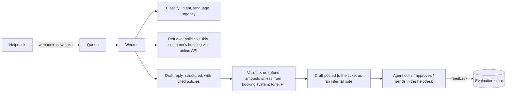

# System design for FDE interviews

FDE system design questions are rarely "design Twitter." They're "a client has *this mess*; what would you build, and how would you get it live?" Interviewers look for discovery questions, sensible simplicity, integration realism, security, evaluation and rollout, not just boxes and arrows.

## A structure that works (45 minutes)

1. **Clarify (5–8 min):** users, volumes, current systems, constraints (data residency, SSO, budget, team), and what success means. Ask before drawing.
2. **Simplest viable design (10 min):** components, data flow, storage. Say what you'd *not* build yet.
3. **Deep dives (15 min):** where the risk is: data quality, integration, permissions, AI evaluation, failure modes.
4. **Operations (5 min):** deployment into *their* environment, monitoring, who owns it.
5. **Rollout and measurement (5 min):** pilot, metrics, handover.

## Practice prompts

1. *A hospital wants staff to ask questions about 2,000 clinical and HR policies. Some are restricted.* (Capstone A.)
2. *A wholesaler wants to stop typing 1,200 invoices a month into their ERP.* (Capstone B.)
3. *An airline's customer-service team wants AI-drafted replies to 5,000 emails a day, in four languages.*
4. *A city council wants to combine three departments' complaint systems into one view for managers.*

## Worked answer (outline): prompt 3, AI-drafted customer-service replies

**Clarifying questions:** Which email system (Gmail, Outlook, a helpdesk like Zendesk or Salesforce Service Cloud)? What share are routine (refund status, baggage) vs complex? Is data allowed to leave the region? Who approves replies today? What does a wrong reply cost (refund promises are legally binding)? Current handling time?

**Design:**

**Key decisions to say out loud:**
- **Drafts inside the existing helpdesk**, not a new UI: adoption is the hardest part.
- **Human sends**, at least until evaluation shows a category is safe for auto-send (e.g. "where's my bag?" with a tracking link).
- **Facts come from systems, not the model:** refund amounts and flight times are fetched from the booking API and inserted, never generated.
- **Evaluation:** a labelled set per intent and language; measure edit distance between draft and sent reply, acceptance rate, handling time; red-team prompt injection in customer emails.
- **Scale:** 5,000/day ≈ 4 a minute on average, with peaks during disruptions (10×); a queue absorbs peaks; batch processing for non-urgent queues.
- **Data:** region-pinned model hosting if required; minimize PII sent; retention aligned with the helpdesk.
- **Rollout:** shadow mode for 2 weeks (drafts generated, not shown), then one team and two intents, then expand by measured category.

**What interviewers want to hear that candidates often skip:** what happens when the model is down (agents work as today), how you'd know quality dropped (acceptance-rate alert), and who owns the policy documents.
