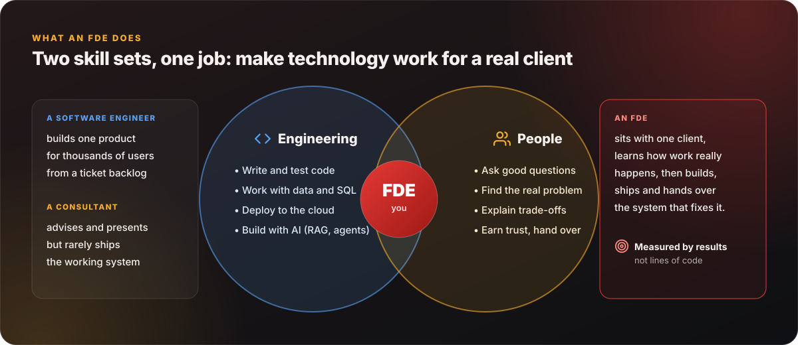

# Lesson 01 — What is a Forward Deployed Engineer?

**Time:** ~1 hour · **Core**

## The one-sentence definition

> A **Forward Deployed Engineer (FDE)** is a software engineer who works directly with a customer, inside their environment, to build and deploy the solution that makes a technology actually deliver value for them.

Each part of that sentence matters:

| Phrase | What it means in practice |
| --- | --- |
| **Software engineer** | You write real, production code. This is not a sales or advisory role, even though it involves both. |
| **Directly with a customer** | You talk to the people who have the problem: users, managers, IT, security. Not just through a product manager. |
| **Inside their environment** | Their data, their systems, their security rules, their politics. Sometimes physically on-site, often remote but embedded in their team. |
| **Build and deploy** | You don't stop at a demo or a recommendation. It has to run in their world. |
| **Actually deliver value** | Success is measured by the customer's outcome (hours saved, revenue gained, errors reduced), not by lines of code or features shipped. |

## Where the name comes from

"Forward deployed" is a military term for units positioned close to where operations happen, rather than at headquarters. The software meaning is the same idea: instead of engineers sitting at company HQ building a general product, some engineers are positioned *forward*, with the customer, where the product meets reality.

The title is most closely associated with **Palantir**, which built much of its business around engineers embedded with customers such as government agencies and large enterprises. Those engineers adapted Palantir's platforms to each customer's data and problems. The model spread from there, and it grew rapidly as companies began adopting AI. AI products in particular tend to need heavy customer-specific work before they're useful.

Today you'll see the role (and variations of it) at AI labs, data and AI platform companies, enterprise software vendors, startups and consultancies.

## Two halves of the same job

Think of an FDE as doing two jobs at once:

Many people are good at one half. FDEs are valuable because they do both. They can sit in a meeting with a hospital's operations director in the morning and debug a data pipeline in the afternoon, and each activity improves the other.

## What FDEs typically do

- Run discovery sessions to understand a workflow and its pain points
- Get access to customer data (often the slowest part!) and make sense of it
- Prototype quickly on real data to prove an idea works
- Build integrations between the product and the customer's existing systems
- Deploy into environments with strict security and compliance requirements
- Train users, write documentation and hand over ownership
- Feed what they learn back to the product team so the product improves

That last point is important. FDEs are often the company's best source of truth about what customers really need. Patterns that FDEs build for one customer often become product features for all of them.

## What an FDE is not

- **Not "a developer who travels."** Location doesn't matter as much as ownership of the customer outcome.
- **Not a salesperson.** FDEs usually work *after* the sale (though some roles help win deals).
- **Not a consultant who only advises.** FDEs build and ship.
- **Not only an "AI engineer."** Many FDE problems are data, integration and workflow problems where AI is a small part, or not needed at all.

## Check yourself

Without looking back, write down:
1. The one-sentence definition in your own words.
2. Two reasons why an FDE's success isn't measured in features shipped.

Next: [Lesson 02 — Why the role exists](02-why-the-role-exists.md)
