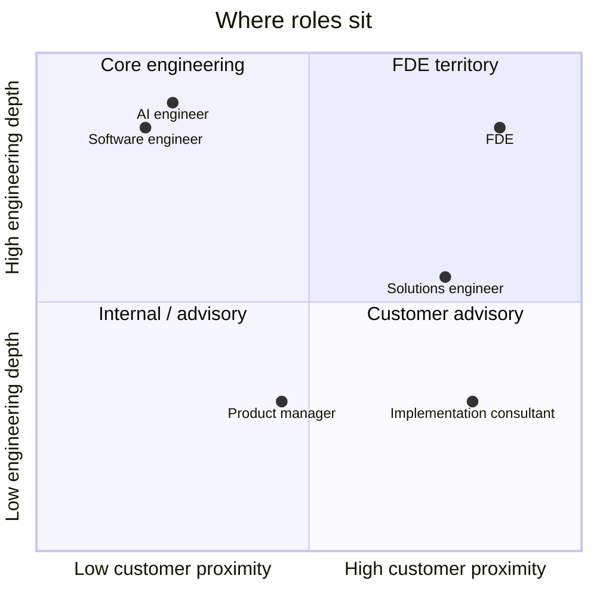

# Lesson 03 — FDE vs. neighbouring roles

**Time:** ~1.5 hours · **Core**

FDE overlaps with several other jobs. Knowing the differences helps you choose roles, read job descriptions and explain your value.

## The comparison

| Role | Main output | Writes production code? | Customer-facing? | Owns the business outcome? | Typical timing |
| --- | --- | --- | --- | --- | --- |
| Software engineer | Product features | Yes | Rarely | Rarely | Continuous |
| AI / ML engineer | Models and AI features | Yes | Rarely | Sometimes | Continuous |
| Solutions / sales engineer | Demos, proofs of concept, technical answers | Prototype level | Yes | Winning the deal | Before the sale |
| Implementation consultant | Configured software, training | Little | Yes | Go-live | After the sale |
| Technical product manager | Requirements, roadmap, priorities | No | Sometimes | Product success | Continuous |
| **Forward Deployed Engineer** | **Working solution deployed in the customer's environment** | **Yes** | **Yes, embedded** | **Yes** | **After the sale (sometimes during)** |

## A useful way to think about it: two axes

The FDE sits in the top-right: deep engineering **and** close to the customer. Most other roles are strong on one axis.

## The differences that matter most

### FDE vs. software engineer
A software engineer builds for *many* users through a product, usually with a PM translating needs. An FDE builds for *one* customer at a time, discovers the needs directly, and often works in an unfamiliar codebase or environment with incomplete information.

### FDE vs. AI engineer
An AI engineer goes deep on models, prompts, retrieval and evaluation. An FDE uses those skills, but spends as much time on data access, integration, permissions and adoption. An AI engineer might ask "How do we improve answer quality by 5%?" An FDE might ask "Will the claims team use this at all, and does it save them time?"

### FDE vs. solutions engineer
Solutions engineers help *sell*: they demo, answer technical questions and build proofs of concept to win deals. FDEs help customers *succeed* after the sale and are accountable for what runs in production. Some companies blend the two.

### FDE vs. implementation consultant
Consultants often configure existing software and advise. FDEs write substantial custom code: integrations, pipelines, applications and AI systems.

### FDE vs. technical PM
Both translate business needs into technical work. The PM decides *what* the product should become; the FDE *builds* what this customer needs now, and feeds patterns back to the PM.

## Same title, different jobs

"Forward Deployed Engineer" doesn't mean the same thing everywhere. Some roles are 80% engineering; others are closer to technical consulting. Some are full-time on-site; others are remote. [Lesson 06](06-reading-job-descriptions.md) teaches you how to tell which is which.

## Check yourself

For each statement, name the role it best describes:
1. "I built the demo that convinced the bank to sign."
2. "I wrote the pipeline that moves the bank's transaction data into our platform and the alerting that tells us when it breaks."
3. "I decided which three features go into next quarter's release."
4. "I improved the retrieval model's recall from 0.71 to 0.83."

(Answers: [exercises/solutions](../exercises/solutions/README.md#lesson-03-check-yourself))

Next: [Lesson 04 — A week in the life](04-a-week-in-the-life.md)
