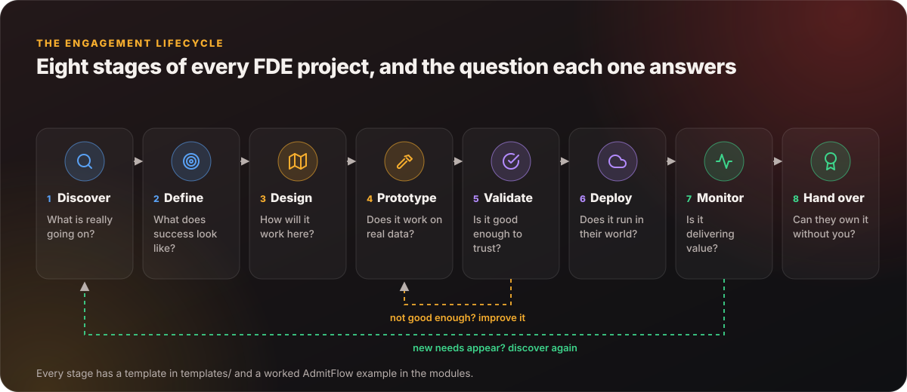

# Lesson 05 — The engagement lifecycle

**Time:** ~2 hours · **Core**

Most FDE engagements follow the same eight stages. You'll return to this map in every module; each later module goes deep on one or two stages.

The arrows going backwards matter. Real engagements loop: validation sends you back to prototyping, and monitoring surfaces new problems that start fresh discovery.

## The stages, using AdmitFlow

Our running example: an educational institute that loses prospective students because enquiries aren't followed up. (Full brief: [projects/admitflow/BRIEF.md](../../../projects/admitflow/BRIEF.md).)

### 1. Discover — *What is really going on?*
Meet stakeholders, watch the work, look at the data.
**AdmitFlow:** You learn enquiries arrive through five channels; counsellors keep personal spreadsheets; nobody tracks which enquiries become admissions.
**Output:** stakeholder map, workflow map, list of pain points and unknowns.
**Common failure:** solving the problem the sponsor *described* rather than the one users *have*.

### 2. Define — *What does success look like?*
Turn the pain into a precise problem with a measurable target.
**AdmitFlow:** "Raise the share of enquiries contacted within 24 hours from ~45% to 90%, and make enquiry-to-admission conversion visible by channel."
**Output:** problem statement, scope (in/out), constraints, success metrics.
**Common failure:** no measurable success criteria, so you can never prove you succeeded.

### 3. Design — *How will it work here?*
Choose an architecture that fits the customer's systems, skills and rules.
**AdmitFlow:** central lead database, webhooks from web forms, counsellor dashboard, reminders, and an AI assistant later.
**Output:** architecture diagram, data flow, integration plan, risks, ADRs.
**Common failure:** ignoring IT and security constraints until it's too late.

### 4. Prototype — *Does it work on real data?*
Build the smallest working slice, on real or realistic data.
**AdmitFlow:** import last month's real enquiries, deduplicate them, show one counsellor their list.
**Output:** a working slice that a real user has touched.
**Common failure:** a toy-data demo that collapses on real data.

### 5. Validate — *Is it good enough to trust?*
Test accuracy, usability, performance and security against the success criteria.
**AdmitFlow:** two counsellors use it for two weeks; you measure response times and collect feedback.
**Output:** evaluation results, feedback, security review.
**Common failure:** "It looked good in the demo."

### 6. Deploy — *Does it run in their world?*
Ship to production in the customer's environment, with training and support.
**Output:** production system, runbook, trained users.
**Common failure:** deploying with no monitoring and no named owner.

### 7. Monitor — *Is it delivering value?*
Track errors, usage, cost and the business metric.
**AdmitFlow:** a weekly dashboard: % contacted within 24h, conversion by channel.
**Output:** dashboards and alerts on technical *and* business metrics.
**Common failure:** measuring uptime but not outcomes.

### 8. Scale & hand over — *Can they own it without you?*
Document, train, transfer ownership, and turn reusable parts into templates or product.
**Output:** handover document, trained internal owner, reusable components.
**Common failure:** the system dies when the FDE leaves.

## Where you'll learn each stage

| Stage | Main module(s) |
| --- | --- |
| Discover, Define | 01, 11 (and the Field Track throughout) |
| Design | 04, 05, 09 |
| Prototype | 03, 04, 08 |
| Validate | 07, 08, 10 |
| Deploy | 06, 09 |
| Monitor | 10 |
| Scale & hand over | 11, 12 |

## Check yourself

Think of a project (any kind: an event, a school assignment, a software project) that went badly. Which of the eight stages was skipped or rushed?

Next: [Lesson 06 — Reading FDE job descriptions](06-reading-job-descriptions.md)
