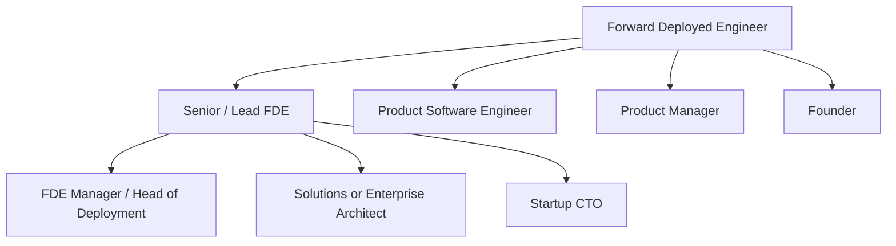

# Lesson 07 — Industries, specializations and careers

**Time:** ~1 hour · **Core**

## Who hires FDEs

| Type of employer | What FDEs do there |
| --- | --- |
| **AI labs and AI platform companies** | Help enterprises deploy models: RAG, agents, evaluation, integration |
| **Data and analytics platforms** | Connect customer data, build pipelines and applications on the platform |
| **Enterprise software vendors** | Customize and integrate the product for large customers |
| **AI and data startups** | Often the first engineers customers meet; very broad role |
| **Consultancies and IT services firms** | FDE-style teams delivering AI and data projects for clients |
| **Government and defence contractors** | Deployments with strict security and on-premise constraints |

### Industries where FDE work is common
Financial services and insurance · healthcare and life sciences · government and public sector · manufacturing and supply chain · energy · retail and logistics · telecommunications · education.

These share a profile: valuable data, complex legacy systems, strict regulation, and a lot to gain from automation.

## Specializations

The core skills are shared, but most FDEs lean in one direction. You'll pick a track after Stage 3.

| Track | Focus |
| --- | --- |
| **AI FDE** | LLM applications, RAG, agents, evaluation |
| **Data FDE** | Pipelines, warehouses, analytics |
| **Software FDE** | Full-stack enterprise applications |
| **Cloud / Platform FDE** | Infrastructure and deployments in customer environments |
| **Enterprise Integration FDE** | CRM/ERP/ITSM integration, identity, migration |

## Career paths

FDE is a strong launch point because you build both engineering depth and business judgment. Common next steps:

- **Senior / Lead FDE:** owns the largest or most complex customers; mentors others
- **Management:** runs a team of FDEs; balances customer demands with company capacity
- **Architecture:** designs solutions across many customers
- **Product engineering or PM:** brings first-hand customer insight into the product
- **Founding a company:** FDEs see many customers' unsolved problems up close

## Honest considerations

- **Pros:** fast learning, high impact, visible results, broad skills, strong demand in the AI era
- **Cons:** context switching, travel in some roles, pressure from customer deadlines, less time for deep specialization

## Check yourself

Which track interests you most right now, and why? (You can change your mind later. Write it down so you can see how your thinking evolves.)

Next: [Case studies](../../../case-studies/README.md), then the [exercises](../exercises/README.md).
