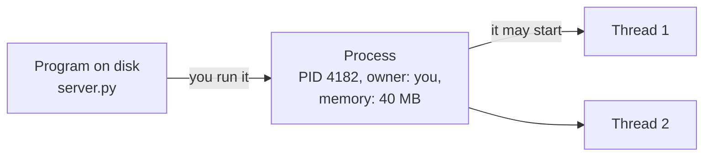

# Lesson 01 — How computers run programs

**Time:** ~2 hours · **Core**

## Why this matters

When a client says "the system is slow," you need a mental model of *what* could be slow: the processor, the memory, the disk or the network. This lesson gives you that model.

## The four parts that matter

| Part | What it does | Analogy | Typical problem it causes |
| --- | --- | --- | --- |
| **CPU** (processor) | Executes instructions, billions per second | The cook | "CPU at 100%": a program is doing heavy work or stuck in a loop |
| **RAM** (memory) | Holds data the CPU is working on *right now*; fast; erased at power-off | The kitchen counter | Out of memory: the program crashes or everything slows down |
| **Storage** (SSD/HDD) | Keeps files permanently; much slower than RAM | The pantry | Disk full: logs or databases stop writing; apps fail strangely |
| **Network** | Connects to other machines | The delivery van | Timeouts, slow responses, "can't connect" |

A rough sense of speed (orders of magnitude, not exact):

| Action | Rough time |
| --- | --- |
| Read from RAM | ~100 nanoseconds |
| Read from an SSD | ~100 microseconds (≈ 1,000× slower than RAM) |
| Network round trip in the same data centre | ~0.5 milliseconds |
| Network round trip across continents | ~150 milliseconds |

This is why "cache it in memory" and "don't call the network in a loop" are common performance fixes.

## Hardware vs. software

- **Hardware:** the physical parts above.
- **Software:** instructions that tell hardware what to do.
  - **Operating system** (Linux, macOS, Windows): manages the hardware and lets programs share it.
  - **Applications:** everything else: browsers, databases, your Python scripts.

## Programs and processes

A **program** is a file on disk: instructions waiting to run. A **process** is a program that is *running*. It has memory, a process ID (PID), and an owner (a user).

- One program can run as many processes at once (e.g. several copies of a web server).
- A **thread** is a sequence of work inside a process. Threads share the process's memory, which lets them cooperate quickly but also lets them interfere with each other.

You'll see processes in action in Lesson 03 with `ps`, `top` and `kill`.

## How your code actually runs

| Kind | How it works | Examples |
| --- | --- | --- |
| **Compiled** | Translated to machine code *before* running; produces an executable | C, Go, Rust |
| **Interpreted / bytecode** | An interpreter reads and runs your code when you start it | Python, JavaScript (Node.js) |

When you run `python3 server.py`, the process is actually the **Python interpreter**, and your file is its input. That's why "which Python is installed?" matters so much (Lesson 04).

*Stretch:* look up "just-in-time (JIT) compilation" to see how JavaScript engines blur this line.

## Watching your own machine

macOS: open *Activity Monitor*. Windows: *Task Manager*. Linux/WSL: run `top` (press `q` to quit).

Find: which process is using the most CPU right now? The most memory?

## Check yourself

A client's report generation takes 10 minutes. During that time, CPU is at 5%, memory is fine, but the program makes 50,000 separate database calls over the network. Which part of the system is the bottleneck, and what would you suggest?

Next: [Lesson 02 — Operating systems, files and permissions](02-operating-systems-and-files.md)
