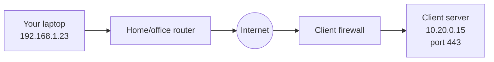

# Lesson 05 — Networking fundamentals

**Time:** ~3 hours · **Core**

## Why this matters

Integration is a huge part of FDE work, and integration means machines talking to machines. When "the integration doesn't work," the cause is very often the network: a firewall rule, a DNS entry, a wrong port, a VPN. You need to be able to narrow it down yourself.

## The big picture



To reach a program on another machine you need:
1. **Its address** (IP address), usually found by looking up a **name** (DNS)
2. **A route** to it: networks, routers, firewalls that allow the traffic
3. **The right port**: which program on that machine should receive it
4. **A protocol** both sides understand (e.g. HTTP)

## IP addresses

An **IP address** identifies a machine (more precisely, a network interface).

- **IPv4:** `93.184.215.14`: four numbers 0–255. Still the most common.
- **IPv6:** `2606:2800:21f:cb07:6820:80da:af6b:8b2c`: longer, increasingly common.

Special ranges you'll see constantly:

| Address | Meaning |
| --- | --- |
| `127.0.0.1` / `localhost` | This machine itself |
| `10.x.x.x`, `172.16–31.x.x`, `192.168.x.x` | **Private** networks: offices, homes, cloud VPCs. Not reachable directly from the internet |
| `0.0.0.0` (when a server listens on it) | "Accept connections on every network interface" |

**Why this matters on a client site:** a server at `10.20.0.15` is on the client's private network. You can only reach it from inside that network, e.g. via their **VPN**.

## DNS: names to addresses

People use names (`api.northbridge.example`); machines use IP addresses. **DNS** (Domain Name System) translates between them, like a phone book.

```bash
dig +short example.com        # macOS/Linux
nslookup example.com          # works almost everywhere
```

Things to know:
- DNS answers are **cached** for a while (the TTL), so changes don't appear instantly everywhere.
- Companies often have **internal DNS** that only works inside their network. A name may resolve on the VPN and fail off it.
- "Is it DNS?" is a running joke among engineers because it so often is.

## Ports: which program?

One machine runs many programs. A **port** number (0–65535) tells the machine which program should receive the traffic.

| Port | Usually |
| --- | --- |
| 22 | SSH |
| 80 | HTTP |
| 443 | HTTPS |
| 5432 | PostgreSQL |
| 6379 | Redis |
| 3000, 5173, 8000, 8080 | Development web servers |

An address plus a port identifies one program: `10.20.0.15:5432` = the Postgres database on that server.

See what's listening on your machine:

```bash
lsof -nP -iTCP -sTCP:LISTEN        # macOS / Linux
```

```bash
ss -ltnp                           # Linux
```

## TCP and UDP

| | TCP | UDP |
| --- | --- | --- |
| Connection | Set up first ("handshake") | None, just send |
| Reliability | Guarantees delivery and order | No guarantees |
| Used for | Web, APIs, databases, SSH: almost everything you'll build | DNS lookups, video calls, streaming |

## Firewalls, VPNs and proxies

- **Firewall:** rules that allow or block traffic by address and port. Corporate networks block most things by default. A request that **hangs and then times out** is often a firewall silently dropping it.
- **VPN:** puts your laptop "inside" a private network remotely.
- **Proxy:** a middleman that corporate traffic must pass through. If `curl` works at home but not on the client's network, check whether a proxy is required (`HTTPS_PROXY` environment variable).

## Two errors worth memorizing

| Error | What it usually means |
| --- | --- |
| **Connection refused** | You reached the machine, but nothing is listening on that port (wrong port, or the app isn't running) |
| **Timed out** | Your traffic never got an answer: firewall, wrong IP, no route, VPN not connected |

This one distinction will save you hours.

## Check yourself

From your laptop on the client's VPN, `curl http://10.20.0.15:8080` returns `Connection refused`. Off the VPN, the same command times out. Explain both results.

Next: [Lesson 06 — HTTP and the client–server model](06-http-and-client-server.md)
