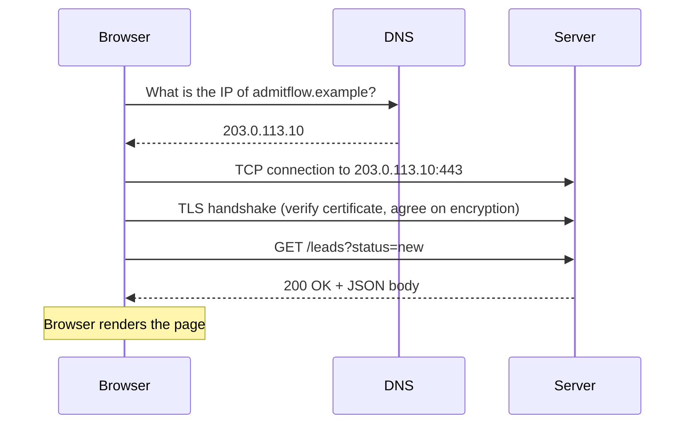

# Lesson 06 — HTTP and the client–server model

**Time:** ~3 hours · **Core**

## Why this matters

Almost every system you integrate (CRMs, payment providers, LLM APIs, the client's internal services) speaks HTTP. In Module 04 you'll build HTTP APIs. Here you learn to read and speak the language with nothing but `curl`.

## Clients and servers

- A **server** is a program that waits for requests and answers them.
- A **client** is a program that sends requests: a browser, a mobile app, `curl`, your Python script, another server.

The same program can be both: your AdmitFlow backend is a *server* for the dashboard and a *client* of the LLM API.

## What happens when you type a URL

Take `https://admitflow.example/leads?status=new`:

| Part | Value |
| --- | --- |
| Scheme | `https` |
| Host | `admitflow.example` |
| Port | 443 (the default for https, so not shown) |
| Path | `/leads` |
| Query string | `status=new` |



## Anatomy of a request and a response

```bash
curl -v https://example.com
```

The `-v` (verbose) flag shows everything. Lines starting with `>` are what you sent; `<` is what came back.

**Request**
```
GET /leads?status=new HTTP/1.1          ← method, path, version
Host: admitflow.example                 ← headers
Accept: application/json
Authorization: Bearer eyJhbGciOi...
                                        ← blank line, then optional body
```

**Response**
```
HTTP/1.1 200 OK                         ← status code
Content-Type: application/json          ← headers
Content-Length: 58

{"leads": [{"id": "ENQ-0001", "name": "Grace Patel"}]}   ← body
```

## Methods

| Method | Meaning | Example |
| --- | --- | --- |
| `GET` | Read | Get the list of leads |
| `POST` | Create / submit | Submit a new enquiry |
| `PUT` / `PATCH` | Replace / update part | Change a lead's status |
| `DELETE` | Remove | Delete a test lead |

## Status codes

| Range | Meaning | Ones to know |
| --- | --- | --- |
| **2xx** | Success | `200 OK`, `201 Created`, `204 No Content` |
| **3xx** | Go somewhere else | `301`/`302` redirects, `304 Not Modified` |
| **4xx** | **Client** problem (your request) | `400 Bad Request`, `401 Unauthorized` (who are you?), `403 Forbidden` (not allowed), `404 Not Found`, `429 Too Many Requests` |
| **5xx** | **Server** problem | `500 Internal Server Error`, `502 Bad Gateway`, `503 Service Unavailable`, `504 Gateway Timeout` |

**FDE reflex:** 4xx → look at what *you* sent. 5xx → look at the server's logs.

## Headers that matter

| Header | Purpose |
| --- | --- |
| `Content-Type` | Format of the body (`application/json`, `text/html`) |
| `Authorization` | Credentials, e.g. an API key or token |
| `Accept` | Format the client wants back |
| `User-Agent` | What kind of client is calling |
| `Retry-After` | With a 429/503: how long to wait before trying again |

## HTTPS and TLS

**HTTPS** = HTTP inside an encrypted **TLS** connection. TLS does two jobs:
1. **Encryption:** nobody in between can read or change the traffic.
2. **Identity:** the server proves it really is `admitflow.example` with a **certificate** signed by a trusted authority.

Certificate errors (`certificate has expired`, `unable to get local issuer certificate`) are common in corporate networks that inspect traffic. **Don't fix them by turning verification off** (`curl -k`, `verify=False`) in real code; find out which certificate the client's network uses.

## Practise with curl

```bash
curl https://example.com                          # GET, print body
curl -i https://example.com                       # include response headers
curl -s -o /dev/null -w "%{http_code}\n" https://example.com   # just the status code
curl -X POST -H "Content-Type: application/json" \
     -d '{"name":"Test Lead","source":"website"}' \
     http://localhost:8000/leads                  # send JSON (you'll build this API in Module 04)
```

Run your own server in one terminal:

```bash
python3 -m http.server 8000
```

Then request it from another terminal with `curl -v http://localhost:8000/`. Watch the server print each request it receives. You're seeing both sides of the conversation.

## Check yourself

The dashboard calls `GET /leads` and gets `401`. The counsellor is logged in. The IT admin says nothing changed on the server. List three things you'd check, in order.

Next: [Lesson 07 — Troubleshooting like an engineer](07-troubleshooting.md)
