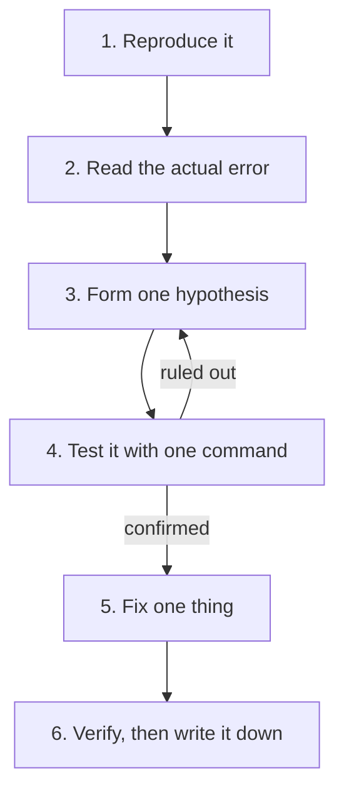

# Lesson 07 — Troubleshooting like an engineer

**Time:** ~2 hours · **Core**

## Why this matters

On a client site, nobody hands you a perfect bug report. You get "it's broken" and a deadline. Systematic troubleshooting, calm and step by step, is one of the most valued FDE skills, and one of the most visible to clients.

## The method

1. **Reproduce it.** Can you make it happen on demand? What exact command, URL or click?
2. **Read the actual error.** Slowly, word by word. The last line of a traceback usually says what went wrong; the lines above say where.
3. **Form one hypothesis.** "The app isn't running." "DNS doesn't resolve on this network." "The env var isn't set."
4. **Test it with one command.** Each test should rule something in or out.
5. **Change one thing at a time.** If you change three things and it works, you don't know which fixed it, or whether the other two broke something else.
6. **Verify and write it down.** Symptom → cause → fix → prevention. That note becomes the runbook entry (Module 10).

## Work through the layers

When something can't talk to something else, check from the bottom up:

| Layer | Question | Command |
| --- | --- | --- |
| Process | Is the program running? | `ps aux \| grep <name>` |
| Port | Is it listening, and on which port/interface? | `lsof -nP -iTCP -sTCP:LISTEN` |
| Local | Does it answer locally? | `curl -v http://localhost:<port>/health` |
| DNS | Does the name resolve, and to what? | `dig +short <host>` or `nslookup <host>` |
| Reachability | Can I reach the machine? | `ping <host>` (often blocked; not conclusive), `nc -vz <host> <port>` |
| HTTP | What does the server answer? | `curl -v https://<host>/path` |
| Application | What does the app say about it? | Logs: `tail -f app.log`, `journalctl -u <service>` |

## Common symptoms decoded

| You see | Likely cause | Next step |
| --- | --- | --- |
| `command not found` | Not installed, or not on `PATH` | `which <cmd>`, `echo $PATH` |
| `permission denied` | Missing execute/read permission, or a protected port/folder | `ls -l`, check owner and mode |
| `No such file or directory` | Wrong path, wrong working directory, or wrong case | `pwd`, `ls`, check spelling and case |
| `KeyError` / "variable not set" | Missing environment variable | `env \| grep <NAME>` |
| `Address already in use` | Another process has the port | `lsof -i :<port>`, then stop it or use another port |
| `Connection refused` | Nothing listening on that port | Is it running? Right port? |
| `Timed out` | Firewall, VPN, wrong IP | Check VPN, ask IT about firewall rules |
| `Could not resolve host` | DNS | `dig`, check VPN/internal DNS |
| `certificate verify failed` | TLS: expired cert or corporate proxy | Check date, ask IT for the corporate CA |
| `4xx` from an API | Your request: auth, URL, body | `curl -v`, read the response body |
| `5xx` from an API | The server's problem | Server logs; retry later; contact the owner |

## Searching for errors effectively

- Copy the **specific** part of the error, not the parts unique to your machine (paths, IDs).
- Add the tool name and version: `"psycopg2" "connection refused" docker`.
- Prefer official docs, GitHub issues and well-voted Q&A answers.
- If an answer says "just disable the security check," keep looking.

## When to ask for help

Spend a focused 20–30 minutes first. Then ask, and **make it easy to help you**:

> **What I'm trying to do:** start the AdmitFlow status server on port 8800.
> **What happens:** `curl localhost:8800/health` → `Connection refused`.
> **What I've checked:** process is running (`ps` shows it); `lsof` shows it on port 8000, not 8800.
> **My current hypothesis:** the port setting isn't being read.
> **Question:** where does the app get its port from?

This format works for teammates, client IT teams and online forums alike. It also often helps you solve the problem yourself while writing it.

## Check yourself

Use the layers table to plan, in order, the first five commands you'd run if a client says: *"Your app at https://admitflow.northbridge.example stopped working this morning."*

Next: try the [break & fix challenge](../break-and-fix/README.md).
