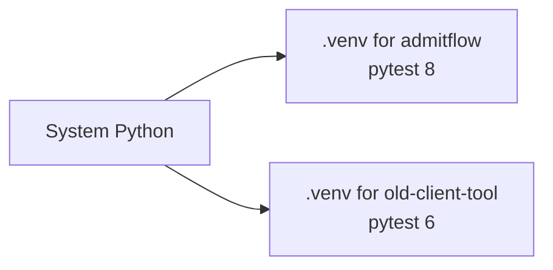

# Lesson 01 — Python setup: running code, the REPL, virtual environments

**Time:** ~2 hours · **Core**

## Why this matters

Before writing any code, you need a setup that behaves the same way on your laptop, a colleague's laptop and a client's server. Most "it doesn't work on the server" problems in Python come from mixing up *which* Python and *which* packages are in use.

## Three ways to run Python

**1. The REPL** (Read–Eval–Print Loop): for trying things out.

```bash
python3
```
```python
>>> 2 + 3
5
>>> "admitflow".upper()
'ADMITFLOW'
>>> exit()
```

**2. A script file:** for anything you want to keep.

```python
# hello.py
name = "Northbridge"
print(f"Hello, {name}!")
```
```bash
python3 hello.py
```

**3. A notebook** (Jupyter): useful for exploring data in Module 07. For now, stick to the REPL and scripts.

## Virtual environments

A **virtual environment** ("venv") is a folder containing its own Python and its own installed packages, separate from every other project.



Create and use one, in every project:

```bash
cd ~/projects/fde-handbook/projects/admitflow
```

```bash
python3 -m venv .venv
```

```bash
source .venv/bin/activate
```

Your prompt now starts with `(.venv)`. Then:

```bash
python -m pip install --upgrade pip
```

```bash
which python
```

`which python` should point inside `.venv`. To leave the venv, run `deactivate`.

> **macOS note:** the Python that comes with macOS ships an old `pip`. Upgrading pip inside the venv (as above) avoids errors such as *"editable mode currently requires a setuptools-based build"*.

**Rules of thumb**
- One venv per project, inside the project folder, named `.venv`.
- Never commit `.venv` to Git (add it to `.gitignore`).
- Inside a venv, `python` and `pip` refer to the venv's copies. Outside, use `python3`.

*Stretch:* [`uv`](https://docs.astral.sh/uv/) is a much faster modern tool that manages Python versions, venvs and packages together. Many teams now use it. Once you understand venvs, try it.

## Your editor

In VS Code, install the **Python** extension (by Microsoft), open the project folder, and choose the `.venv` interpreter (Command Palette → *Python: Select Interpreter*). You get auto-complete, error highlighting and a debugger (Lesson 13).

## Check yourself

1. You install a package with `pip install httpx` and your script still says `ModuleNotFoundError: No module named 'httpx'`. Give two possible causes.
2. Why shouldn't you commit `.venv` to Git?

Next: [Lesson 02 — Values, variables and types](02-values-and-variables.md)
