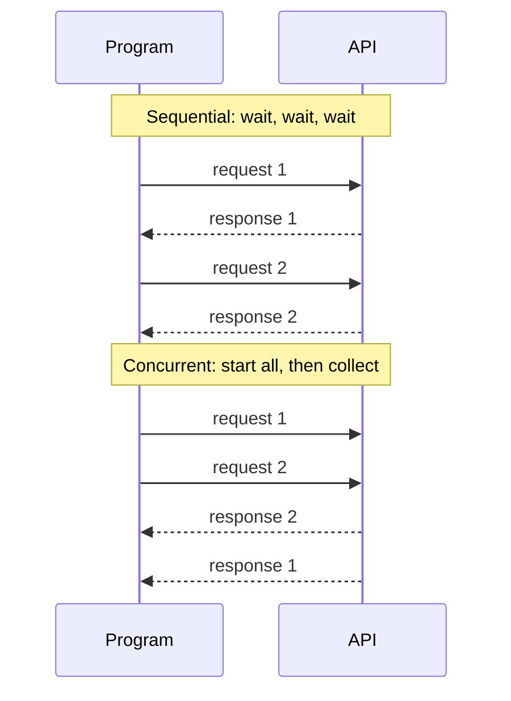

# Lesson 15 — Async basics

**Time:** ~2 hours · **Core** (concepts) / *Stretch* (going deeper)

## Why this matters

Much of an FDE's code spends its time **waiting**: for an API, a database, an LLM. If you need 200 API calls that each take 1 second, doing them one after another takes over 3 minutes. Doing them *concurrently* (overlapping the waits) can take a few seconds. FastAPI (Module 04) and most LLM SDKs (Module 08) are built around async, so you need to recognize it.

## The idea



Async doesn't make your code compute faster. It stops your program sitting idle while it waits.

## async and await

```python
import asyncio

async def fetch_status(lead_id: str) -> str:
    await asyncio.sleep(1)          # stands in for a network call
    return f"{lead_id}: ok"

async def main():
    ids = [f"ENQ-{i:04d}" for i in range(1, 11)]
    results = await asyncio.gather(*(fetch_status(i) for i in ids))
    print(results)

asyncio.run(main())                 # ~1 second, not ~10
```

- `async def` defines a **coroutine** function. Calling it doesn't run it; it creates a coroutine object.
- `await` pauses *this* coroutine until the result is ready, letting others run meanwhile.
- `asyncio.gather` runs many coroutines concurrently and collects the results.
- `asyncio.run` starts the event loop from normal code.

## Real HTTP calls, concurrently

```python
import asyncio
import httpx

async def main():
    async with httpx.AsyncClient(timeout=10) as client:
        urls = ["https://example.com", "https://example.org"]
        responses = await asyncio.gather(*(client.get(u) for u in urls))
        for r in responses:
            print(r.url, r.status_code)

asyncio.run(main())
```

## Be a polite client: limit concurrency

Firing 1,000 requests at once will hit rate limits (429s) or overload the client's server. Use a semaphore:

```python
limit = asyncio.Semaphore(5)        # at most 5 at a time

async def polite_get(client, url):
    async with limit:
        return await client.get(url)
```

## Common mistakes

| Mistake | Effect |
| --- | --- |
| Forgetting `await` | You get a coroutine object, not the result (and a warning) |
| Calling blocking code (`time.sleep`, `requests.get`) inside async code | Blocks *everything*. Use `asyncio.sleep`, `httpx.AsyncClient` |
| Using async for CPU-heavy work | No speed-up; async helps with waiting, not computing |

## When to use it

Use async when you have many independent network waits, or when your framework is async (FastAPI, many LLM SDKs). For a simple script that makes a few calls, synchronous code is simpler and perfectly fine.

## Check yourself

Modify the first example to run 50 `fetch_status` calls with at most 10 at a time. Roughly how long should it take, and why?

Next: [Lesson 16 — Data structures and Big-O](16-data-structures-and-big-o.md)
