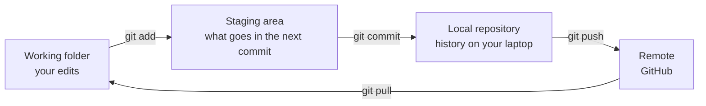

# Lesson 17 — Git and GitHub

**Time:** ~5 hours · **Core**

## Why this matters

Git is how teams (and clients) track every change to code: who changed what, when and why, with the ability to undo anything. On an engagement, your Git history *is* part of the deliverable. A clean history with clear messages makes handover far easier.

## The mental model



- A **commit** is a saved snapshot of the project, with a message.
- A **branch** is a movable label pointing at a line of commits.
- A **remote** is a copy of the repository elsewhere (GitHub).

## Everyday commands

```bash
git status                 # what's changed? (run this constantly)
git diff                   # exact changes not yet staged
git add admitflow/normalize.py tests/test_normalize.py
git commit -m "Normalize phone numbers to E.164"
git log --oneline -10      # recent history
git push                   # send commits to GitHub
git pull                   # get others' commits
```

Stage specific files rather than `git add .`, so you don't commit something by accident (secrets, large data, `.venv`).

## .gitignore

List files Git should never track:

```
.venv/
__pycache__/
.env
*.log
leads.json
```

If you ever commit a secret, **assume it's compromised**: revoke the key immediately. Deleting it in a later commit doesn't remove it from history.

## Good commit messages

```
Normalize phone numbers to E.164 format

Ad exports use (202) 555-0141, walk-ins use 202 555 0141.
Both now become +12025550141 so dedupe can match them.
```

- First line: what the commit does, in the imperative ("Add", "Fix"), ≤ ~60 characters.
- Optional body: **why**, and anything a reviewer should know.
- One logical change per commit.

## Branches and pull requests

Never work directly on `main`. For each piece of work:

```bash
git switch -c feature/phone-normalization   # create and switch to a branch
# ...edit, test, commit...
git push -u origin feature/phone-normalization
```

Then on GitHub, open a **pull request** (PR): a request to merge your branch into `main`, where others review the changes.

A good PR description:
- **What** changed and **why** (link to the issue or requirement)
- **How it was tested**
- Anything reviewers should look at closely

After approval, merge it, then update your local `main`:

```bash
git switch main
```

```bash
git pull
```

## Merge conflicts

When two branches change the same lines, Git asks you to decide:

```
<<<<<<< HEAD
"da": "Data Analytics",
=======
"da": "Data Analysis",
>>>>>>> feature/course-codes
```

Edit the file to the correct final version, delete the markers, then `git add` the file and `git commit`. Run the tests before committing the resolution.

## Undoing things (safely)

| Situation | Command |
| --- | --- |
| Discard unstaged changes to a file | `git restore file.py` |
| Unstage a file | `git restore --staged file.py` |
| Fix the last commit's message (not yet pushed) | `git commit --amend` |
| Undo a pushed commit | `git revert <commit>` (creates a new commit that reverses it) |

Avoid rewriting history that others have already pulled (`git push --force`) unless your team agrees.

## Forking this handbook

To submit your own work:
1. **Fork** the handbook on GitHub (your own copy).
2. Clone your fork, create branches, push to your fork.
3. Open PRs **within your fork** (`feature/...` → `main`) to practise the review flow. Ask a peer to review.

## Check yourself

1. You accidentally committed `.env` (with an API key) and pushed it. What are the first two things you do?
2. Write a commit message for: "changed the walk-in date parsing because dates were coming out as the wrong month."

Next: [Lesson 18 — JavaScript essentials](18-javascript-essentials.md)
