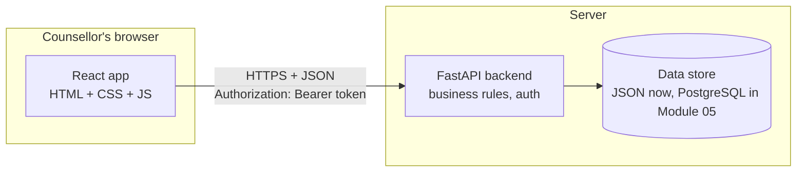
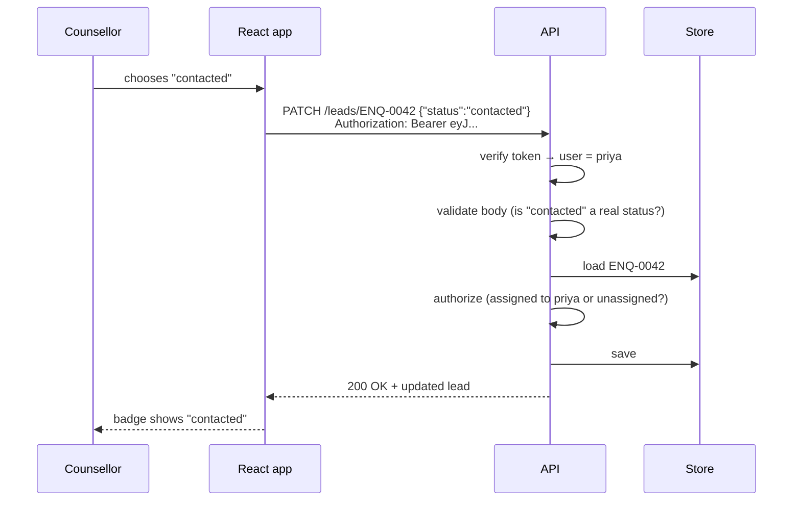

# Lesson 01 — How a web application fits together

**Time:** ~2 hours · **Core**

## Why this matters

Before you write a line of the dashboard, you need a map: which parts exist, where each runs, and what travels between them. On client sites, the first thing you'll often do is draw this map for *their* system, because nobody else has.

## The three parts

| Part | Runs where | Responsible for | Never trust it to… |
| --- | --- | --- | --- |
| **Frontend** (React) | The user's browser | Showing data, collecting input, good experience | Enforce rules. Anyone can edit JavaScript in their browser |
| **Backend** (API) | Your server | Validation, authorization, business rules, talking to storage and other systems | Be reachable only by your frontend. Anyone can call it with `curl` |
| **Data store** | Server / managed service | Durable storage | Be reachable from the internet. It should only accept the backend |

**The golden rule:** every rule that matters (who can see what, what's valid) is enforced in the **backend**. The frontend may *also* check, for a nicer experience, but the backend is the authority.

## One request, end to end

A counsellor changes a lead's status to "contacted":

Each arrow is a place something can fail. A good design makes each failure clear: 401, 422, 404, 403, network error.

## Where state lives

- **Server state:** the leads, notes, users. The source of truth.
- **Client state:** which filter is selected, what's typed into a box, which lead is open. Temporary.
- **Session:** who's logged in, carried by a token the browser sends with each request.

Bugs often come from mixing these up, e.g. trusting a "role" stored in the browser instead of checking it on the server.

## Monolith first

For an FDE engagement, start with **one backend service + one frontend + one database**: a *modular monolith*. Split into microservices only when there's a real reason (separate teams, very different scaling needs). Every extra service is something the client's small IT team has to deploy, monitor and understand after handover.

*Stretch:* read about "microservices vs monolith" trade-offs. Notice how many experienced engineers recommend starting with a monolith.

## Check yourself

Draw the AdmitFlow architecture yourself (paper or Mermaid). Then mark: (1) where a lead's status is validated, (2) where "only admins can assign" is enforced, (3) what would break if the API server were down but the frontend still loaded.

Next: [Lesson 02 — Designing HTTP APIs](02-api-design.md)
