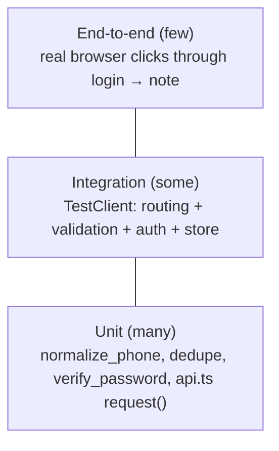

# Lesson 08 — Testing strategy

**Time:** ~4 hours · **Core**

## The testing pyramid



| Level | AdmitFlow examples | Speed | Catches |
| --- | --- | --- | --- |
| Unit | `tests/test_normalize.py`, `web/src/api.test.ts` | ms | Logic errors |
| Integration | `tests/test_api.py` with `TestClient` | ms–s | Wiring: wrong status codes, missing auth, validation gaps |
| End-to-end | (stretch) Playwright script driving the real UI | seconds | Things only visible together: CORS, broken buttons |

## API integration tests with TestClient

```python
from fastapi.testclient import TestClient

@pytest.fixture
def client(tmp_path):
    repo = JsonRepository(tmp_path / "store.json")
    repo.add_leads(import_file(DATA / "leads_sample.csv", "website").leads)
    repo.save_user(User("priya", "Priya Nair", "counsellor", hash_password(PASSWORD)))
    return TestClient(create_app(repo))

def auth(username, role="counsellor"):
    return {"Authorization": f"Bearer {create_token(username, role)}"}

def test_counsellor_cannot_assign(client):
    response = client.patch("/leads/ENQ-0001", json={"assigned_to": "priya"}, headers=auth("priya"))
    assert response.status_code == 403
```

Each test gets a **fresh** store (`tmp_path`), so tests never affect each other.

## What to test in an API

For each endpoint, aim to cover:
- ✅ the happy path (right status code, right body)
- 🔒 **no token → 401**, **wrong role → 403**
- 🚫 invalid input → 422 with the right field named
- 🔍 not found → 404
- 📄 pagination boundaries (first page, last page, page size cap)
- 🧭 business rules (counsellor can't edit others' leads; duplicates merge)

Security tests are the ones most often missing, and they catch the most dangerous bugs. **Write a 401 test for every protected endpoint.** A parametrized test can loop over all routes.

## Frontend tests

Unit-test logic outside components first (`api.ts`), mocking `fetch`:

```ts
vi.stubGlobal("fetch", vi.fn(async () => new Response(JSON.stringify(body), { status: 401 })));
await expect(request("/auth/login")).rejects.toMatchObject({ status: 401 });
```

Then test components with [Testing Library](https://testing-library.com/), asserting what the **user** sees ("shows an error message when login fails"), not implementation details.

*Stretch:* [Playwright](https://playwright.dev/) runs real browser end-to-end tests: log in, open a lead, add a note, check it appears. One or two such tests catch integration problems unit tests can't, such as CORS.

## Test data

- Use **realistic** data: the AdmitFlow samples include accents, scripts, duplicates and blank values deliberately.
- Never use real client personal data in tests or fixtures. Generate or anonymize it.
- Build data with small helper functions (`lead(...)`, `auth(...)`) so tests stay readable.

## Coverage and CI

Run all tests on every pull request (Module 06 sets up GitHub Actions). Keep a coverage floor (80%) as a safety net, but judge test quality by asking: *if I broke this rule, would a test fail?*

## A note on slow tests

AdmitFlow's API tests take ~12 seconds, mostly because PBKDF2 with 600,000 iterations is *deliberately* slow. Options: create users once per test module (fixture `scope="module"`), or use fewer iterations **in tests only** via configuration. Never weaken production hashing to speed up tests.

## Check yourself

List every endpoint in your build. For each, check you have a 401 test, a validation test (if it takes input), and a 403 test (if roles matter). Fill the gaps.

Next: [Lesson 09 — Engineering practice](09-engineering-practice.md)
