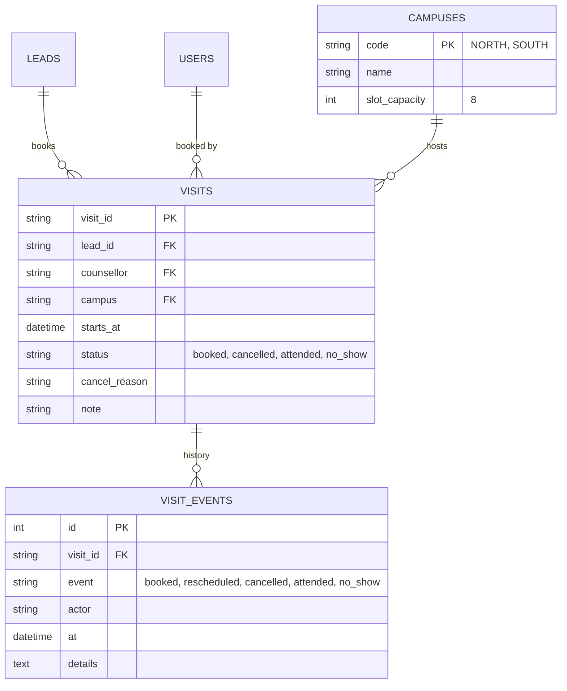

# Exercise 02 — Model answer: campus visits

## ERD



A `campuses` table (rather than a hard-coded `CHECK`) lets the institute add a campus or change capacity without a code change.

## Tables

```sql
CREATE TABLE campuses (
    code           VARCHAR(10) PRIMARY KEY,
    name           VARCHAR(100) NOT NULL,
    slot_capacity  INTEGER NOT NULL CHECK (slot_capacity > 0)
);

CREATE TABLE visits (
    visit_id       VARCHAR(32) PRIMARY KEY,
    lead_id        VARCHAR(40) NOT NULL REFERENCES leads(lead_id) ON DELETE CASCADE,
    counsellor     VARCHAR(64) NOT NULL REFERENCES users(username),
    campus         VARCHAR(10) NOT NULL REFERENCES campuses(code),
    starts_at      TIMESTAMP NOT NULL,
    status         VARCHAR(12) NOT NULL DEFAULT 'booked'
                   CHECK (status IN ('booked', 'cancelled', 'attended', 'no_show')),
    cancel_reason  TEXT,
    note           TEXT,
    CHECK (status <> 'cancelled' OR cancel_reason IS NOT NULL),
    CHECK (extract(minute FROM starts_at) = 0)          -- on the hour (PostgreSQL syntax)
);

CREATE TABLE visit_events (
    id        SERIAL PRIMARY KEY,
    visit_id  VARCHAR(32) NOT NULL REFERENCES visits(visit_id) ON DELETE CASCADE,
    event     VARCHAR(20) NOT NULL,
    actor     VARCHAR(64) NOT NULL,
    at        TIMESTAMP NOT NULL,
    details   TEXT
);
```

## Indexes

| Index | Serves |
| --- | --- |
| `visits (campus, starts_at) WHERE status = 'booked'` (partial index, PostgreSQL) | Capacity check; reception's "today at North" list |
| `visits (counsellor, starts_at)` | "My upcoming visits" |
| `visits (lead_id)` | Visits shown on a lead's detail page |
| `visit_events (visit_id, at)` | Visit history |

## Enforcing "8 per slot"

**In application code only:** `SELECT COUNT(*) … ; if count < 8: INSERT …`. Two counsellors booking the last slot at the same moment both see 7 and both insert, giving **9**. This is a race condition.

**Safer options:**
1. **Lock, then check, in one transaction** (PostgreSQL): `SELECT … FROM campuses WHERE code = 'NORTH' FOR UPDATE;` then count and insert. Concurrent bookings for that campus wait their turn. Simple and correct at this scale.
2. **A slots table** with one row per (campus, hour) and a `booked` counter: `UPDATE slots SET booked = booked + 1 WHERE campus = ? AND starts_at = ? AND booked < capacity;` If 0 rows updated, the slot is full. The single `UPDATE` is atomic.
3. **SERIALIZABLE isolation** plus retry on conflict.

Recommended: option 2 or 1, plus an API test that fires two concurrent bookings at the last slot.

## Open questions surfaced by modelling

- Does a parent attending count toward capacity? (May need a `party_size` column.)
- Can a visit be rescheduled to another campus? (Yes, but it must re-check capacity.)
- Retention: how long should visit history be kept?
