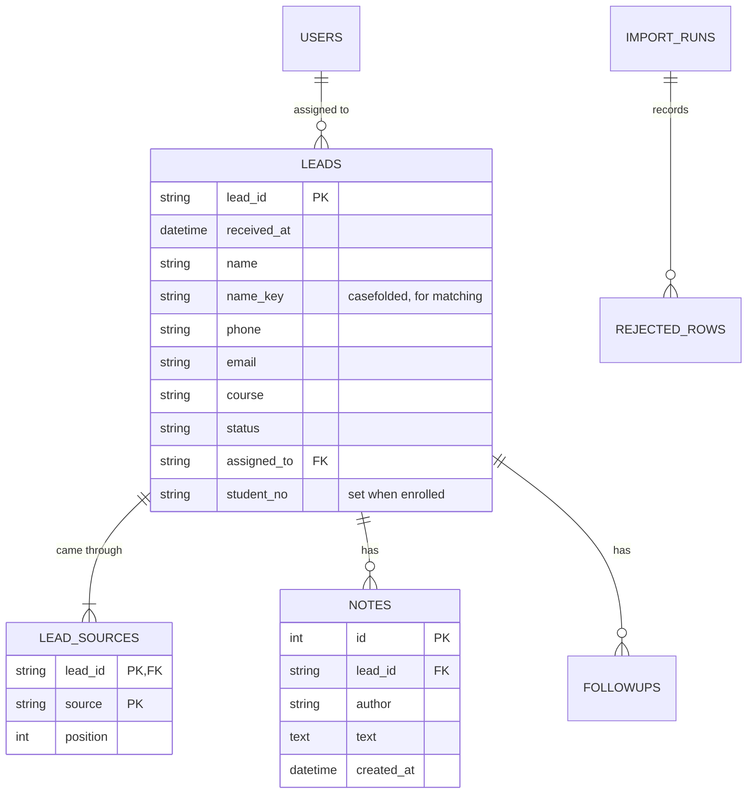

# Lesson 01 — Relational thinking and data modelling

**Time:** ~4 hours · **Core**

## Why this matters

The JSON file worked for a pilot. But when Mr. Fernandes asks "which ad campaigns produce students who actually enrol?", you need to combine leads, channels and admissions, across thousands of records, reliably, with several people writing at once. That's what relational databases are for. A good data model makes those questions easy; a bad one makes them impossible.

## Tables, rows, columns, keys

A **table** holds one kind of thing (leads); each **row** is one instance (one lead); each **column** is one attribute (name, received_at).

- **Primary key:** uniquely identifies a row (`leads.lead_id`).
- **Foreign key:** a column referring to another table's primary key (`notes.lead_id → leads.lead_id`). The database refuses notes for leads that don't exist.
- **Constraints:** rules the database enforces: `NOT NULL`, `UNIQUE`, `CHECK (fee > 0)`.

Let the database enforce what it can. Code has bugs; constraints don't forget.

## The AdmitFlow model

Full definitions: [`admitflow/db.py`](../../../projects/admitflow/admitflow/db.py).

## Relationships

| Kind | Example | How it's stored |
| --- | --- | --- |
| One-to-many | A lead has many notes | Foreign key on the "many" side (`notes.lead_id`) |
| Many-to-many | Leads ↔ channels | A **join table** (`lead_sources`) |
| One-to-one | A lead ↔ an admission | A unique column (`leads.student_no UNIQUE`) or a separate table |

## Normalization, in practice

**Normalization** means storing each fact once, in the right place.

- **No lists in a column (1st normal form).** The JSON store kept `sources: ["website", "ad"]`. In SQL that becomes rows in `lead_sources`, so "how many leads came via WhatsApp?" is a simple, indexable query instead of string searching.
- **No repeated facts.** Don't copy the counsellor's full name into every lead; store `assigned_to` and look the name up in `users`. Change it in one place.
- **No values derived from other values**, unless deliberately cached for speed (and kept in sync).

**When to denormalize:** reporting tables and analytics often copy data deliberately to make queries fast and simple. That's fine *as a derived copy*, rebuilt from the normalized source.

## Choosing types

| Data | Type | Watch out for |
| --- | --- | --- |
| IDs from other systems | `VARCHAR`/`TEXT` | Leading zeros vanish if stored as numbers |
| Money | `INTEGER` (cents) or `NUMERIC(10,2)` | Never `FLOAT` |
| Timestamps | `TIMESTAMP` (with or without time zone, deliberately) | Record your choice ([ADR-002](../../../projects/admitflow/docs/adr/002-local-time.md)) |
| Phone numbers | `VARCHAR` | Not numbers: `+`, leading zeros |
| Status | `VARCHAR` + `CHECK`, or an enum | Keep the allowed list in one place |
| Free text | `TEXT` | Unicode: use UTF-8 databases |

## Natural vs. surrogate keys

- **Natural key:** something meaningful (`student_no`, `email`). Meanings change, emails get typed wrong, and two systems disagree.
- **Surrogate key:** a generated ID (`lead_id`, `id SERIAL`, a UUID). Stable and meaningless.

Use surrogate primary keys, and put `UNIQUE` constraints on natural keys where they really must be unique.

## Check yourself

Extend the model for **campus visits** (Module 04, Exercise 01): a visit belongs to a lead and a counsellor, happens at a campus and time, and has a status and a cancellation reason. Draw the ERD. Which columns need constraints? (Answer: [Exercise 02](../exercises/02-data-model.md).)

Next: [Lesson 02 — SQL fundamentals](02-sql-fundamentals.md)
