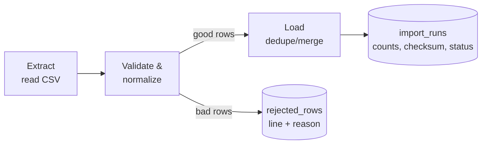

# Lesson 06 — Data pipelines: ingestion, quality and matching

**Time:** ~5 hours · **Core**

## Why this matters

Clients' data arrives from systems you don't control: weekly exports, nightly dumps, APIs, spreadsheets someone emails. A **pipeline** moves it into your system reliably, every time, and tells you when something's wrong. Most "the AI is giving wrong answers" problems turn out to be pipeline problems.

## ETL and ELT

| | ETL | ELT |
| --- | --- | --- |
| Order | Extract → **Transform** → Load | Extract → Load raw → **Transform** in the database |
| Where cleaning happens | In code (Python) before loading | In SQL inside the warehouse (often with dbt) |
| Good for | Operational apps (AdmitFlow) | Analytics warehouses with lots of raw data |

AdmitFlow is ETL: importers normalize in Python, then load clean rows.

## The four properties of a trustworthy pipeline



1. **Idempotent:** running it twice gives the same result as once. AdmitFlow records each file's SHA-256 checksum and skips files it has already loaded, and the dedupe rules mean even a forced re-run merges rather than duplicates.
2. **Auditable:** every run is recorded (`import_runs`): file, time, counts, status.
3. **Reconcilable:** `read = loaded + merged + rejected`, asserted on every run. If the numbers don't add up, stop.
4. **Loud about bad data:** rejected rows are stored with line numbers and reasons, never silently dropped (remember the Module 03 break & fix).

Code: [`admitflow/pipeline.py`](../../../projects/admitflow/admitflow/pipeline.py).

```bash
admitflow ingest --website data/leads_sample.csv --ads data/ad_leads.csv --walkins data/walkins.csv
```

```
leads_sample.csv: read 120, new 120, merged 0, rejected 0
ad_leads.csv: read 60, new 50, merged 10, rejected 0
walkins.csv: read 25, new 20, merged 5, rejected 0
```

Run it again:

```
leads_sample.csv: skipped (already loaded)
```

## Data quality checks

Validate at several levels:

| Level | Example check | On failure |
| --- | --- | --- |
| Row | Date parses; name has a letter; source is known | Reject the row, record why |
| File | Expected columns present; row count within normal range | Fail the run before loading anything |
| Dataset | No duplicate emails; every note has a lead; enrolments ≤ leads | Alert someone |
| Business | This week's leads within ±50% of last week's | Flag for human review |

A file with 3 rows when you normally get 900 probably isn't "a quiet week." It's a broken export. Check volume.

## Matching records across systems (entity resolution)

The admissions office uses a different system (the SIS) with its own IDs, name format (`"NAIR, Tom"`) and phone format (`02025550123`). To answer "which channels produce students who enrol?", you must **match** SIS records to leads:

1. **Normalize both sides the same way** (names, emails, phones; including the SIS's leading `0`).
2. **Match on strong keys first** (email), then weaker combinations (phone **and** name), never on weak keys alone (phone only: families share phones).
3. **Record the link** (`leads.student_no`) so matching is idempotent.
4. **Report what didn't match**, with reasons. 3 of 25 admissions didn't match a lead: they may be direct applications, or data entry errors. That list is valuable to the client.

```bash
admitflow match-admissions data/admissions_export.csv
```

```
matched 22, already matched 0, unmatched 3
```

*Stretch:* fuzzy matching (e.g. edit distance between names) catches typos, but always review fuzzy matches with a human before acting on them.

## Batch vs. streaming

- **Batch:** process a file or a day's data at a time (AdmitFlow imports). Simple and robust.
- **Event-driven / streaming:** process each event as it happens (a webhook per website form submission, Module 09; Kafka at large scale). Lower latency, more moving parts.

Start with batch unless the business genuinely needs minutes or seconds.

## Scheduling

A pipeline that someone has to remember to run will stop being run. Options, from simplest:
1. A cron job or scheduled cloud task running `admitflow ingest` (Module 06)
2. A workflow orchestrator (Airflow, Dagster, Prefect) when there are many dependent steps, retries and backfills (Lesson 08)

## Check yourself

What happens in AdmitFlow if the ad platform changes its export and renames `phone_number` to `phone`? Trace it through `importers.py` and `pipeline.py`. Is the failure loud or silent? How would you make it fail **before** loading anything? (Hint: a file-level column check.)

Next: [Lesson 07 — NoSQL and caching](07-nosql-and-caching.md)
