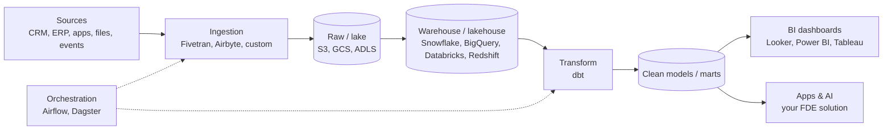

# Lesson 08 — The modern data stack and data governance

**Time:** ~3 hours · **Core** (concepts) / *Stretch* (tools)

## Why this matters

Large clients won't have one database. They'll have a **data platform**: a warehouse, pipelines, orchestration, BI dashboards, governance rules. As an FDE you'll often *plug into* that platform rather than build your own, and you'll need to speak its language with the client's data team.

## The typical stack

| Concept | Meaning |
| --- | --- |
| **Operational database (OLTP)** | Runs the app: many small reads/writes (AdmitFlow's PostgreSQL) |
| **Warehouse (OLAP)** | Built for analytics: big scans and aggregates over lots of history |
| **Data lake** | Cheap storage of raw files (CSV, JSON, Parquet) in object storage |
| **Lakehouse** | Warehouse-style tables on top of lake storage (Databricks, Iceberg/Delta tables) |
| **dbt** | Transformations written as SQL `SELECT`s, version-controlled and tested |
| **Orchestrator** | Runs pipeline steps on schedules with dependencies, retries and backfills |
| **Streaming** | Kafka, Kinesis, Pub/Sub: events processed continuously |

*Stretch:* do the free [dbt Fundamentals](https://learn.getdbt.com/) course, and try Airflow's tutorial. Both show up frequently in data-FDE job descriptions.

## When AdmitFlow would need a warehouse

Not now. One PostgreSQL database answers every question at this scale. A warehouse makes sense when you combine many sources, keep years of history, or analysts need heavy queries that would slow the operational app. Then you'd copy (replicate) AdmitFlow's tables into the warehouse and report from there.

## Data governance and privacy

Governance means knowing **what data you have, where it is, who can access it, and how long you keep it**. For an FDE handling client data, these are non-negotiable:

| Practice | In AdmitFlow terms |
| --- | --- |
| **Data inventory** | Which tables hold personal data (leads: name, phone, email; notes may contain anything) |
| **Least privilege** | Counsellors see leads; only admins export; the app's database user can't drop tables |
| **Minimization** | Don't import columns you don't need (the SIS `fee_paid` flag: do we need it?) |
| **Retention** | Delete or anonymize leads after N months without contact, as the client's policy requires |
| **Access logging** | Who exported what, when (Module 10) |
| **Environments** | Never copy real personal data to laptops or test databases; use synthetic or anonymized data |
| **Lawful basis** | Data-protection laws (e.g. GDPR in Europe, DPDP Act in India) set rules on consent, purpose and rights to deletion. The client's legal/privacy team decides; you implement and document |

**PII** (personally identifiable information) is any data that identifies a person, directly (name, email, phone) or in combination (course + campus + enrolment date might identify someone in a small class).

## Data contracts (a habit worth building)

When you depend on another team's export, agree a **data contract**: columns, types, meanings, formats, delivery schedule, and who to call when it breaks. Even a one-page document prevents the "they renamed a column and nobody told us" incident.

## Check yourself

Write a one-page **data inventory** for AdmitFlow: every table, which columns are personal data, who can access them, how long they should be kept (propose a policy), and what happens when a student asks to be deleted.

Next: [Exercises](../exercises/README.md) and the [build](../build.md).
