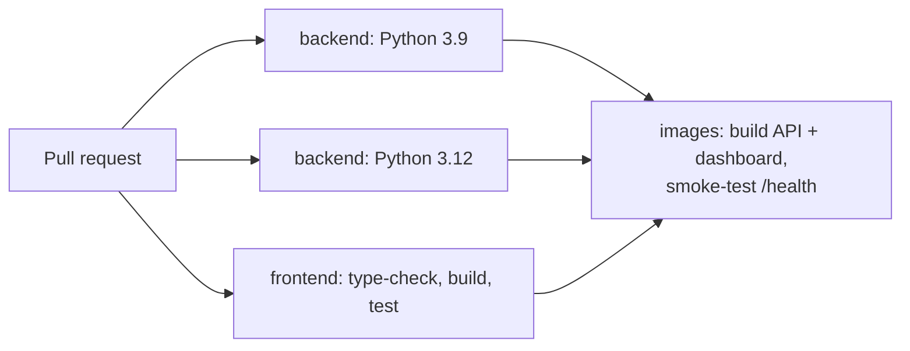

# Lesson 05 — CI/CD with GitHub Actions

**Time:** ~4 hours · **Core**

## Why this matters

**Continuous integration (CI):** every change is automatically tested before it's merged. **Continuous delivery/deployment (CD):** every merged change can be (or is) deployed automatically. Together they mean you never ship something that hasn't passed the tests, and deploying is a routine, boring button-press instead of a stressful evening.

For an FDE, CI is also a **handover asset**: the client's team inherits a safety net, not just code.

## GitHub Actions basics

Workflows are YAML files in `.github/workflows/`. Each has **triggers** (`on:`), **jobs** (run in parallel by default, on fresh virtual machines), and **steps** (commands or reusable actions).

```yaml
name: CI
on:
  pull_request:
  push:
    branches: [main]
jobs:
  test:
    runs-on: ubuntu-latest
    steps:
      - uses: actions/checkout@v4          # get the code
      - uses: actions/setup-python@v5
        with: { python-version: "3.12" }
      - run: pip install -e ".[dev]"
      - run: pytest
```

## AdmitFlow's pipeline

[`.github/workflows/admitflow-ci.yml`](../../../.github/workflows/admitflow-ci.yml):



What's worth copying:

- **A matrix** (`python-version: ["3.9", "3.12"]`): the client's server may run an older Python than your laptop.
- **A real PostgreSQL service container**: the contract tests run against JSON, SQLite *and* PostgreSQL, so "works on SQLite" can't hide PostgreSQL problems.
- **Tests in two time zones**: time-zone bugs only show up in some zones (Module 04).
- **`alembic upgrade head` + `alembic check` against PostgreSQL**: migrations are proven to apply and to match the models.
- **Building the images and calling `/health`**: catches a broken Dockerfile or a wrong `HOST` before anyone deploys.
- **`paths:` filters**: only run when relevant files change.
- **`permissions: contents: read`**: the workflow gets the minimum access it needs.

The handbook also checks itself: [`handbook-ci.yml`](../../../.github/workflows/handbook-ci.yml) runs every exercise solution and checks every internal link, monthly as well as on pull requests, so library updates that break lessons get noticed.

## Protect the main branch

In GitHub → Settings → Branches, require pull requests and passing status checks before merging to `main`. Then "the tests passed" is a fact, not a hope.

## Secrets in CI

Store credentials under Settings → Secrets and variables → Actions, and reference them as `${{ secrets.NAME }}`. They're masked in logs. Better still for cloud deploys: **OIDC federation** (`google-github-actions/auth`, `aws-actions/configure-aws-credentials`) lets the workflow get short-lived cloud credentials with no long-lived key stored anywhere.

## Continuous deployment, carefully

A typical flow once CI is green:

1. Merge to `main` → build and push the image tagged with the commit SHA (`api:3f2c9e1`), never just `latest`
2. Deploy automatically to **staging**; run smoke tests
3. Deploy to **production** after a manual approval (GitHub *environments* with required reviewers)

Run database migrations as an explicit step before the new version receives traffic, and make them backward compatible (Lesson 07).

## Check yourself

Write a workflow for the course-catalogue service that runs its tests on Python 3.9 and 3.12 and builds its Docker image ([Exercise 02](../exercises/02-ci-workflow.md)). Push it to your fork and open a pull request that deliberately breaks a test. Confirm the PR shows a red ✗.

Next: [Lesson 06 — Deploying to the cloud](06-deploying.md)
