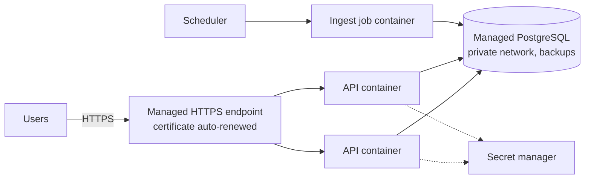

# Lesson 06 — Deploying to the cloud

**Time:** ~6 hours · **Core**

## Why this matters

This is where the client's users actually get the system. The goal isn't the most sophisticated architecture. It's one the client's team can understand, afford, and keep running after you leave.

## The shape of a typical deployment

Managed container platforms (Cloud Run, AWS App Runner/ECS Fargate, Azure Container Apps) give you HTTPS, scaling, revisions and logs without managing servers. You bring a container image and configuration.

## The walkthrough

Follow [`projects/admitflow/deploy/README.md`](../../../projects/admitflow/deploy/README.md). It deploys AdmitFlow to Google Cloud Run with Cloud SQL, step by step, and maps every step onto AWS and Azure. In outline:

1. **Registry:** create one and push (or cloud-build) the API image
2. **Database:** managed PostgreSQL, smallest suitable tier, backups on, **no public IP**
3. **Secrets:** signing key and database URL in the secret manager
4. **Identity:** a dedicated service account with only the roles it needs (connect to the database, read two secrets)
5. **Migrate:** run `alembic upgrade head` as a one-off job
6. **Deploy:** the API service with secrets and environment variables; startup probe on `/ready`, liveness on `/health`
7. **Dashboard:** build with the API's real URL; serve from a container or object storage + CDN
8. **Verify:** `/health`, `/ready`, then log in through the real dashboard in a browser

## Health checks: liveness vs. readiness

| Endpoint | Question | Used for |
| --- | --- | --- |
| `/health` (liveness) | Is the process alive? | Restart it if not |
| `/ready` (readiness) | Can it serve requests right now (database reachable)? | Send it traffic only when yes |

Keep liveness cheap and dependency-free; otherwise a database blip makes the platform restart every container at once. AdmitFlow's `/ready` returns `503` when storage is unavailable, which is how break & fix problem #2 was diagnosed.

## Scaling and cold starts

Platforms like Cloud Run can **scale to zero** when idle (cheapest) and start an instance on the first request (a few seconds' delay: a "cold start"). For six counsellors, scale-to-zero with `min_instances=0` is fine; set `min_instances=1` if the first-request delay bothers users. Always cap `max_instances`, both to control cost and to avoid exhausting database connections.

## Domains and HTTPS

Map a domain the client owns (`admitflow.northbridge.example`) to the service; managed platforms issue and renew TLS certificates automatically. The client's IT controls DNS, so request the record early: it's a classic last-minute blocker.

## Scheduled jobs

The weekly ingest shouldn't depend on someone remembering to run it:
- Google Cloud: Cloud Run **job** + Cloud Scheduler
- AWS: EventBridge Scheduler → ECS task
- Azure: Container Apps **job** with a cron trigger
- Single server: a systemd timer or cron running `docker compose run --rm api admitflow ingest …`

Make jobs report their results: AdmitFlow's `import_runs` table records every run. Alert if no successful run happened this week (Module 10).

## Deploying into the client's environment

Often you won't have your own cloud account at all:
- Work in the **client's** account, with an account they create for you, scoped to a project or resource group.
- Expect **restrictions:** approved regions, approved base images, no public IPs, private networking only, mandatory tags, change-approval processes.
- Expect a **security review** before go-live. Have the architecture diagram, data flows, and secrets handling ready to show (Module 09).
- Some clients require **on-premise** or **in-VPC** deployment. Containers help, because the same image runs there.

## Check yourself

Deploy AdmitFlow (or just the course-catalogue service) to a free tier or trial of your chosen provider. Record: every resource created, its monthly cost estimate (Lesson 08), and the commands to delete everything afterwards. **Then delete everything**, and confirm the bill.

Next: [Lesson 07 — Configuration, secrets, environments and releases](07-config-secrets-releases.md)
