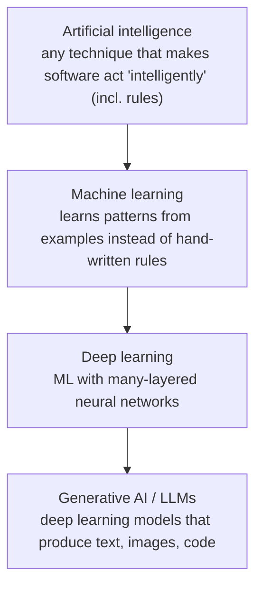

# Lesson 01 — What AI and machine learning are (and when not to use them)

**Time:** ~2 hours · **Core**

## Why this matters

Clients ask for "AI" when they mean very different things: a rule, a report, a prediction, a chatbot. Part of an FDE's value is translating the request into the right tool, and saying honestly when ML isn't it.

## The vocabulary

| Kind of ML | Learns from | AdmitFlow example |
| --- | --- | --- |
| **Supervised** | Examples with known answers (labels) | Past leads + whether they enrolled → predict for new leads |
| **Unsupervised** | Data without labels | Group enquiries into similar types (clustering) |
| **Reinforcement** | Rewards from trial and error | Rarely relevant to FDE work (*awareness only*) |

Supervised tasks are either **classification** (a category: enrol / not) or **regression** (a number: days until enrolment).

## Training vs. inference

- **Training:** fit the model to historical examples. Done occasionally (each intake).
- **Inference:** use the trained model on a new case. Done constantly (every new lead).

They often run in different places: train in a notebook or job, serve inference in the API (Lesson 05).

## When ML is the right tool

- There's a **repeated decision** at volume (hundreds of leads a month)
- You have **historical examples with outcomes** (hundreds to thousands, at least)
- The pattern is **too fuzzy for rules** but present in the data
- An imperfect answer is **useful**, and mistakes are tolerable or can be reviewed

## When it isn't

| Situation | Better tool |
| --- | --- |
| The rule is known ("leads waiting > 24h go first") | Code / SQL |
| The question is "what happened?" | A report (Module 05) |
| No labelled history | Collect data first; start with rules |
| Mistakes are very costly and unexplainable answers aren't allowed | Rules + human decision |
| The real problem is a process (nobody calls back) | Fix the process |

**AdmitFlow, honestly:** the biggest gain available to the institute is calling leads within 24 hours, which is a process fix. This module builds the scoring model anyway, *and measures that it adds only a little*. Learning to show that clearly is as valuable as learning to build the model.

## Where generative AI fits

LLMs (Module 08) are excellent at language: answering questions from documents, drafting messages, extracting fields from text. They're poor at precise prediction from tabular data, which is what scikit-learn-style models are for. Use each for what it's good at.

## Check yourself

For each request, say: rule, report, classic ML, LLM, or process change, and why.
1. "Flag leads who haven't been called in 2 days."
2. "Which ad campaign gives the most enrolments per rupee?"
3. "Answer students' questions about fees and timings at night."
4. "Predict which students will drop out in the first term."
5. "Make counsellors respond faster."

Next: [Lesson 02 — Data for machine learning](02-data-for-ml.md)
