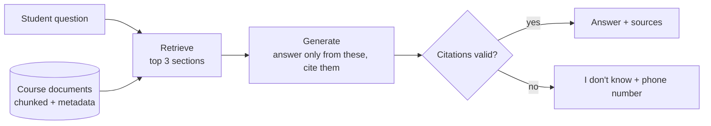

# Lesson 03 — Retrieval-augmented generation (RAG)

**Time:** ~6 hours · **Core**

## Why RAG

A model doesn't know Northbridge's 2026 fees, and shouldn't be trusted to remember them. **RAG** retrieves the relevant passages from the client's own documents at question time and asks the model to answer from those, with citations.



RAG is preferred over fine-tuning for factual Q&A because documents change (new fees every year), answers can cite sources, and permissions can be enforced per document.

## Step 1: ingest and chunk

Split documents into **chunks** small enough to be specific, big enough to make sense alone.

| Strategy | Pros | Cons |
| --- | --- | --- |
| Fixed size (e.g. 400 characters) | Simple | Cuts tables and sentences in half (the break & fix) |
| **By structure** (headings, sections) | Each chunk is one idea, with its heading | Sections vary in size |
| Fixed size with overlap | Fewer cut-off ideas | Duplicated text; still ignores structure |
| Semantic (split where the topic changes) | Good boundaries | More complex |

AdmitFlow chunks by `##` section and prefixes each chunk with "document title — section" so it makes sense on its own ([`rag.py`](../../../projects/admitflow/admitflow/rag.py)).

**Keep metadata with every chunk:** source document, section, effective date, superseded flag, and, in larger systems, **access permissions**. Metadata is what lets retrieval filter out outdated or forbidden content.

Real documents are messier than Markdown: PDFs, scans, Word files, web pages, spreadsheets. Budget real time for **parsing** (text extraction, tables, OCR for scans). It's usually the hardest part.

## Step 2: retrieve

| Method | Matches | AdmitFlow |
| --- | --- | --- |
| **Keyword (BM25)** | Shared words, weighted by rarity | ✅ default: pure Python, transparent |
| **Vector (embeddings)** | Similar meaning | Lesson 04 |
| **Hybrid** | Both, combined | Recommended as corpora grow |
| **Reranking** | A second model re-orders the top 20–50 candidates | Stretch |

Before ranking, **filter** by metadata: `superseded = false`, `effective_from <= as_of`, and permissions (only documents this user may see).

Keyword search misses paraphrases ("evening classes" vs. "evening batch"). AdmitFlow uses three cheap fixes, then measures:
1. a tiny stemmer (instalments → instalment)
2. ignoring filler words ("get", "offer", "much")
3. explicit query expansion ("how much" → "fee")

…and one content fix: an **FAQ document written from questions students actually ask**. When the evaluation showed gaps, improving the documents beat clever code.

## Step 3: generate a grounded answer

Give the model the retrieved chunks with IDs, and require citations:

```
<documents>
<document chunk_id="fees-2026#diploma-fees" title="Fee schedule 2026–27" section="Diploma fees">
…
</document>
</documents>

<question>How much is Data Analytics?</question>
```

Then **verify in code** ([`llm.py`](../../../projects/admitflow/admitflow/llm.py) `_grounded`): drop citations to sections that weren't retrieved; if nothing valid remains, return "I don't know." Don't rely on the prompt alone.

## Step 4: say "I don't know" well

A good refusal is helpful: "I'm not sure about that from our course information. A counsellor can help: call … or email …". AdmitFlow's evaluation has unanswerable questions ("PhD in astrophysics", "capital of France") and requires 100% correct declines.

## The offline baseline

AdmitFlow's default answerer is **extractive**: it picks the best-matching sentences from the top chunk and never writes anything new. It's free, deterministic, and runs in CI. On the 52-case evaluation:

```
correct 0.904 · retrieval@3 1.0 · correct declines 1.0 · fees 13/13
```

The 5 failures are cases where it picks the right section but the wrong sentence. That's exactly where a language model helps, and why you evaluate the model against the same cases before switching it on.

```bash
admitflow ask "Do you offer evening classes?"
```

```bash
admitflow eval-assistant
```

```bash
admitflow eval-assistant --llm claude      # needs credentials; costs money per run
```

## Permissions in RAG

If documents have different audiences (staff-only policies, student records), filter by the **user's permissions at retrieval time**, before anything reaches the model. Never retrieve everything and hope the prompt keeps secrets. Module 03's hospital case study is this exact failure.

## Check yourself

Do the [break & fix](../break-and-fix/README.md). Then add a new document, `hostels.md`, with two sections, and add three evaluation cases for it. Does anything else get worse?

Next: [Lesson 04 — Embeddings and vector search](04-embeddings-and-vector-search.md)
