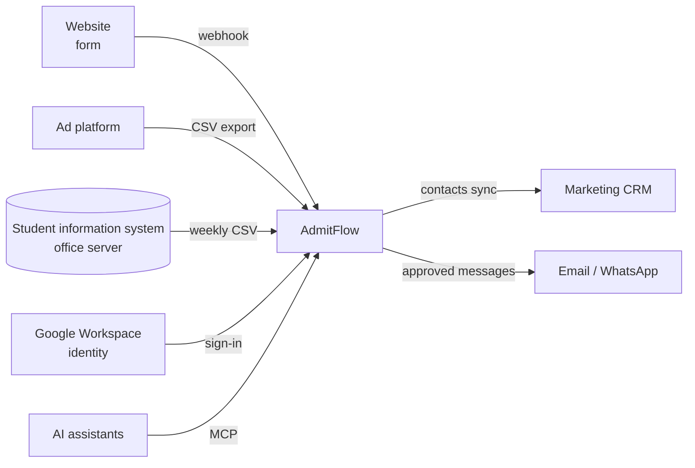

# Lesson 01 — The enterprise landscape: systems you have to work with

**Time:** ~2 hours · **Core**

## Why this matters

No client starts from a blank page. AdmitFlow already touches a website, an ad platform, spreadsheets, a student information system (SIS), email and WhatsApp. A large client might have hundreds of systems. Most FDE effort goes into fitting new software into that landscape without breaking what people rely on.

## Draw the map first

On any engagement, one of your first artefacts is an **integration map**:

For each arrow, note: direction, frequency, format, who owns each end, what happens when it fails, and how you'd know.

## Systems of record

For every important piece of data, agree on **one system of record**: the place that's authoritative when systems disagree.

| Data | System of record | Others hold copies |
| --- | --- | --- |
| Enquiries and follow-ups | AdmitFlow | CRM (synced) |
| Enrolled students, fees paid | SIS | AdmitFlow (matched) |
| Marketing consent, unsubscribes | CRM | AdmitFlow should respect it |
| Staff identities | Google Workspace | AdmitFlow (users) |

Unclear ownership leads to sync loops ("each system overwrites the other") and arguments about whose number is right.

## Kinds of systems you'll meet

| Kind | Examples | Typical integration |
| --- | --- | --- |
| **CRM** (customers, sales, marketing) | Salesforce, HubSpot, Microsoft Dynamics 365 | REST APIs, webhooks, bulk APIs |
| **ERP** (finance, HR, supply chain) | SAP, Oracle, Dynamics 365 F&O, NetSuite | APIs (often SOAP/OData), files, middleware |
| **ITSM** (tickets, IT operations) | ServiceNow, Jira Service Management | REST APIs, webhooks |
| **Data platforms** | Snowflake, Databricks, BigQuery, Palantir Foundry | SQL, connectors, platform SDKs |
| **Low-code** | Microsoft Power Platform, Salesforce Flow | Connectors calling your APIs |
| **Legacy / custom** | The office SIS, a 15-year-old Access database | Files, database reads, screen scraping as last resort |
| **Identity providers** | Google Workspace, Microsoft Entra ID, Okta | OIDC, SAML, SCIM |

Lesson 07 looks at the major platforms.

## Monoliths, microservices and legacy

Large clients often run a mix: an old monolith that "nobody dares touch," newer microservices, and SaaS. Practical rules:
- **Integrate at the edges**; don't change a legacy system's internals unless its owners ask.
- Prefer **documented interfaces** (APIs, exports) over reading another system's database directly. A database is an implementation detail that can change without notice.
- When reading the database is the only option, use **read-only credentials** on a **replica or view**, agreed in writing with the owner.

## On-premise, cloud and hybrid

The SIS runs on a server in the office; AdmitFlow runs in the cloud. Options for connecting them, from simplest:
1. **Scheduled file export** to a shared folder or storage bucket (what AdmitFlow does weekly)
2. A small **agent** inside the office network that pushes data out (outbound connections pass most firewalls)
3. **VPN** or private connectivity between networks (needs network team involvement)

Outbound-only designs are usually far easier to get approved than opening inbound ports into a client's network.

## Check yourself

Draw the integration map for an organization you know (or the hospital from Module 03's case study). For every arrow, fill in: format, frequency, owner, failure behaviour, and system of record for the data it carries.

Next: [Lesson 02 — Integration patterns](02-integration-patterns.md)
