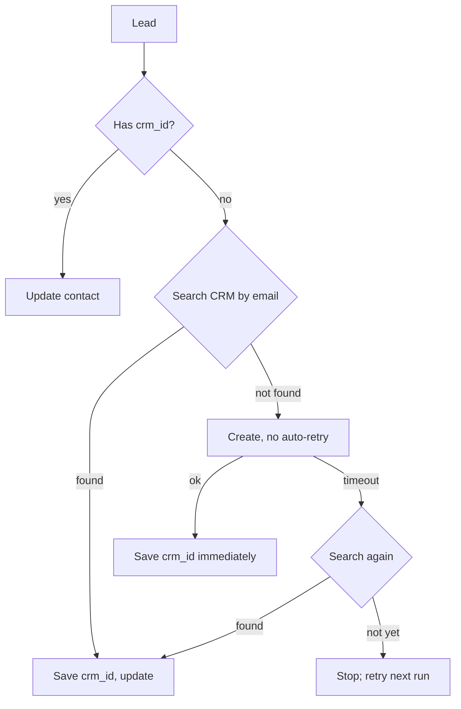

# Lesson 04 — Calling third-party APIs reliably

**Time:** ~4 hours · **Core**

## The core question

For every call to another system, ask: **"What happens if this runs twice? What if it times out?"** Networks are unreliable, and a timeout means *unknown*, not *failed*.

## Idempotent and non-idempotent operations

| Operation | Safe to retry? |
| --- | --- |
| `GET` / search | ✅ Yes |
| `PUT` / `PATCH` setting fields to values | ✅ Usually (same result each time) |
| `DELETE` | ✅ Usually |
| `POST` create | ❌ **No**, unless the API supports idempotency keys |
| "Send message", "charge card" | ❌ **No** |

Retry the safe ones with backoff. For the unsafe ones: use the provider's **idempotency key** if offered (a unique key per logical operation; the server ignores repeats), or **check before you retry**.

## Retries with backoff

```python
RETRYABLE = {429, 500, 502, 503, 504}

for attempt in range(1, attempts + 1):
    try:
        response = client.request(method, url, json=body)
    except httpx.TimeoutException:
        problem = "timeout"
    else:
        if response.status_code not in RETRYABLE:
            response.raise_for_status()
            return response.json()
        problem = f"HTTP {response.status_code}"
    if attempt == attempts:
        raise CrmError(f"gave up after {attempt} attempts ({problem})")
    sleep(2 ** (attempt - 1))              # 1, 2, 4… seconds; add jitter in production
```

Respect `Retry-After` on 429s, cap total attempts, and never retry 4xx errors other than 429. They won't fix themselves.

## Idempotent sync: the AdmitFlow pattern

[`integrations/crm.py`](../../../projects/admitflow/admitflow/integrations/crm.py):



This turns the break & fix's 141 duplicates into 0.

## Pagination and rate limits

Third-party APIs return data in pages (cursors, `after` tokens, `next` links) and limit how fast you can call them. Read the docs for both before writing the loop. Process in batches, track a **cursor** so a crashed job resumes where it stopped, and spread work over time rather than bursting.

## Sync direction and conflicts

| Direction | Rule |
| --- | --- |
| One-way (AdmitFlow → CRM) | AdmitFlow wins for synced fields; marketing edits them only in AdmitFlow |
| Two-way | Needs per-field ownership ("CRM owns `unsubscribed`, AdmitFlow owns `status`") or last-write-wins with timestamps, plus loop prevention |

Start one-way. Two-way sync is where integrations go to die, unless field ownership is written down and agreed.

## The outbox for messages

[`integrations/messaging.py`](../../../projects/admitflow/admitflow/integrations/messaging.py) sends **only approved** drafts, records the provider's message ID, and leaves failures `approved` with the reason, so they're retried. It's **at-least-once**: a crash between "provider accepted" and "we recorded it" could send twice. The window is kept tiny (record immediately after each send) and documented. For some channels, the provider offers message IDs or keys you can check before resending.

**Messaging rules are real constraints:** business messaging platforms (WhatsApp Business, SMS in many countries) require opt-in, restrict free-form messages to recent conversations, and require pre-approved templates to start conversations. Email needs a properly configured sending domain (SPF, DKIM, DMARC) or it lands in spam. Check these with the client early; they can take weeks to approve.

## Testing integrations without the real service

Use a fake: `httpx.MockTransport` with an in-memory implementation that can **fail on purpose** (time out after saving, return 503s). AdmitFlow's `FakeCrm` and the break & fix's `FlakyCrm` do exactly that. Then run a smoke test against the vendor's **sandbox** account before production.

## Check yourself

Add an `unsubscribed` flag to leads that the CRM owns: the sync must *read* it from the CRM and never overwrite it. Write the test first. What happens if a student unsubscribes in the CRM and then sends a new enquiry through the website?

Next: [Lesson 05 — Identity: OAuth, OpenID Connect, SAML and SSO](05-identity-and-sso.md)
