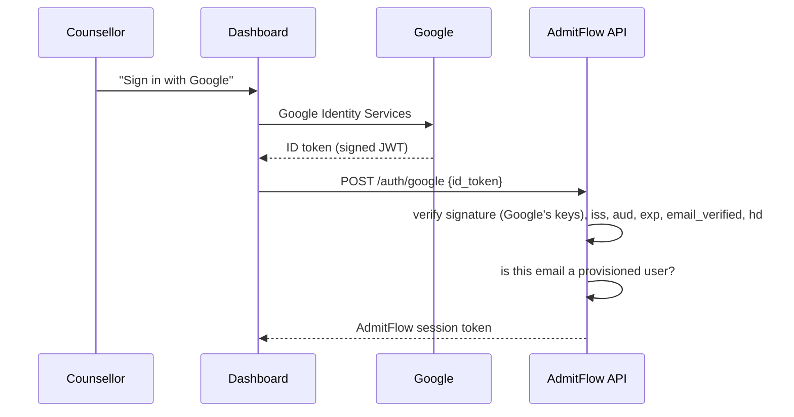

# Lesson 05 — Identity: OAuth, OpenID Connect, SAML and SSO

**Time:** ~4 hours · **Core**

## Why

Enterprises don't want another password per app. They want staff to sign in with the **company identity** (Google Workspace, Microsoft Entra ID, Okta), where IT controls passwords, multi-factor authentication and, crucially, **leavers**. Disable someone's company account and they lose access everywhere at once. Single sign-on (SSO) is often a hard requirement in security reviews.

## The vocabulary

| Term | Means |
| --- | --- |
| **Identity provider (IdP)** | Who verifies the person: Google, Entra ID, Okta |
| **OAuth 2.0** | A framework for granting an app **access** to an API on a user's behalf (authorization) |
| **OpenID Connect (OIDC)** | A layer on OAuth 2.0 that tells the app **who the user is** (authentication), via an **ID token** |
| **SAML 2.0** | An older XML-based SSO standard, still common in large enterprises |
| **ID token** | A signed JWT from the IdP: issuer, audience, subject, email, expiry |
| **Access token** | A credential to call an API (may or may not be a JWT) |
| **SCIM** | A standard for the IdP to create and remove users in your app automatically |
| **Service account** | A non-human identity for system-to-system calls |

## AdmitFlow's Google sign-in



The verification ([`integrations/oidc.py`](../../../projects/admitflow/admitflow/integrations/oidc.py)):

```python
signing_key = jwks_client.get_signing_key_from_jwt(token)        # Google's current public keys
claims = jwt.decode(token, signing_key.key, algorithms=["RS256"], audience=client_id,
                    options={"require": ["exp", "iat", "iss", "aud", "sub"]})
if claims["iss"] not in ("https://accounts.google.com", "accounts.google.com"): raise SsoError(...)
if not claims.get("email_verified"): raise SsoError(...)
if claims.get("hd") != allowed_domain: raise SsoError(...)
```

Every check matters:
- **Signature:** proves Google issued it
- **`aud` = our client ID:** otherwise a token issued to *any* app using Google sign-in would work on ours
- **`exp`:** rejects old tokens
- **`hd`** (hosted domain): only the institute's Workspace accounts, not any Gmail user
- **Provisioned user:** a valid Google identity isn't enough; the person must exist in AdmitFlow (`403` otherwise)

Tests generate their own RSA key and sign tokens with it, so every rejection path is covered offline (`tests/test_integrations.py`).

## Which flow?

| App type | Recommended flow |
| --- | --- |
| Browser app + your API (AdmitFlow) | IdP's sign-in library → ID token → your API verifies; or **Authorization Code + PKCE** with a backend |
| Server-to-server | **Client credentials** (service account) |
| Mobile / desktop | Authorization Code + PKCE |
| Large enterprise IdP requiring SAML | A SAML library, or an identity broker (Auth0, Keycloak, Entra ID) that speaks SAML to them and OIDC to you |

Don't implement OAuth/SAML protocol details yourself beyond verification; use maintained libraries or the IdP's SDK.

## Provisioning and leavers

SSO handles sign-in; you still need to decide **who has an account** and **with what role**:
- **Manual:** an admin creates users (AdmitFlow: `admitflow create-user priya@northbridge.example --role counsellor`)
- **Group mapping:** a Google/Entra group "admitflow-counsellors" grants the role
- **SCIM:** the IdP creates, updates and **deactivates** users automatically. It's the gold standard for leavers.

Also: keep AdmitFlow's own session short (8 hours), so a disabled Google account loses access within a working day.

## Service accounts and API keys

For system-to-system access (the website's webhook, the CRM token, an MCP client):
- one credential **per integration**, never shared
- **least privilege:** only the scopes it needs
- stored in the secret manager; rotated on a schedule and immediately on suspicion
- an owner and an expiry date recorded

## Check yourself

Map AdmitFlow's identities: every human role and every system credential (webhook secret, CRM token, SMTP password, WhatsApp token, LLM API key, MCP user). For each: who owns it, what it can do, where it's stored, how it's rotated, and what happens when the person responsible leaves.

Next: [Lesson 06 — Permissions, multi-tenancy and audit](06-permissions-and-audit.md)
