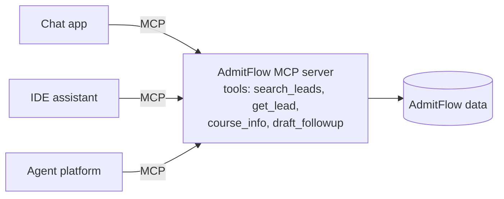

# Lesson 08 — Model Context Protocol: giving AI safe access to systems

**Time:** ~3 hours · **Core**

## Why MCP

Clients increasingly want their AI assistants (in chat apps, IDEs, agent platforms) to work with internal systems: "find my overdue leads," "draft a follow-up for Grace." Without a standard, every AI app needs custom glue for every system. The **Model Context Protocol (MCP)** is an open standard: build an MCP **server** for your system once, and any MCP-capable **client** can use its tools.



An MCP server exposes **tools** (actions with typed inputs), and can also expose **resources** (readable data) and **prompts** (templates).

## AdmitFlow's MCP server

[`admitflow/mcp_server.py`](../../../projects/admitflow/admitflow/mcp_server.py), using the official Python SDK (`mcp` 2.x, Python 3.10+):

```python
from mcp.server.mcpserver import MCPServer
from mcp.server.mcpserver.exceptions import ToolError

server = MCPServer("AdmitFlow", instructions="… You can search, read and draft, but never send …")

@server.tool()
def get_lead(lead_id: str) -> dict:
    """Details and note history for one lead you are allowed to see."""
    lead = repo.get_lead(lead_id)
    if lead is None or not visible(lead):
        raise ToolError(f"lead {lead_id} not found")      # same message either way
    return {"lead_id": lead.lead_id, "name": lead.name, "course": lead.course, …}
```

Run it for a counsellor (the stdio transport is what desktop AI apps launch):

```bash
admitflow mcp --user priya
```

In an MCP client's configuration, this becomes an entry like `{"command": "admitflow", "args": ["mcp", "--user", "priya"]}`. Check your client's documentation for the exact format.

**SDK versions change:** in `mcp` 1.x the server class was `FastMCP`; in 2.x it's `MCPServer`, and unexpected exceptions are hidden from clients unless raised as `ToolError`. Pin the version and read the migration notes before upgrading.

## Designing MCP tools safely

| Principle | AdmitFlow |
| --- | --- |
| **Act as a specific identity** | `--user priya`: tools see only Priya's leads |
| **Least privilege** | No send, update, delete or approve tools exist at all |
| **Don't leak existence** | Hidden and missing leads give the same "not found" |
| **Minimize data** | `get_lead` returns `has_email: true`, not the address |
| **Side effects produce drafts** | `draft_followup` creates a `pending_approval` draft and says so |
| **Clear descriptions** | The model chooses tools from their descriptions; say what they do and don't do |
| **Bounded inputs** | Queries truncated; `limit` capped at 25 |
| **Audited** | Drafts record who requested them |

Remember Module 08 Lesson 07: anything a tool returns (notes, emails, documents) can contain prompt injections. The protection is that no tool can do anything dangerous with them.

## Remote MCP servers

For shared, hosted use, MCP also runs over HTTP (`server.run("streamable-http")`). Then you need authentication (the protocol supports OAuth), TLS, rate limits and the same security review as any API. Start with local stdio for a pilot.

## Testing

Tool functions can be called directly in tests ([`tests/test_mcp.py`](../../../projects/admitflow/tests/test_mcp.py)):

```python
def test_tools_are_read_and_draft_only(setup):
    names = {tool.name for tool in asyncio.run(server.list_tools())}
    assert names == {"search_leads", "get_lead", "course_info", "draft_followup"}
```

Then try it in a real MCP client and watch what the model does with the tools. Good descriptions often matter more than code.

## Check yourself

Add a `my_followups_due` tool (follow-ups due in the next 24 hours for the acting counsellor). Write tests proving it never returns another counsellor's follow-ups. Then connect the server to an MCP client and ask: "What should I do first this morning?"

Next: [Exercises](../exercises/README.md) and the [build](../build.md).
