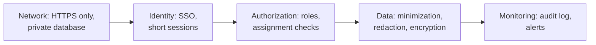

# Lesson 01 — Security foundations: threat modelling and the OWASP Top 10

**Time:** ~4 hours · **Core**

## Why this matters

By now AdmitFlow holds thousands of students' contact details, sends messages in the institute's name, talks to a CRM, an AI provider and Google, and has a public endpoint. Each of those is a way in. Security isn't a feature added at the end; it's a habit of asking **"how could this be abused?"** about everything you build, and fixing the answers in priority order.

## Threat modelling in 30 minutes

For each component in the architecture diagram, ask four questions (adapted from the threat-modelling community):
1. **What are we building?** (the diagram, with data flows and trust boundaries)
2. **What can go wrong?**
3. **What are we doing about it?**
4. **Did we do a good job?** (tests, reviews)

A simple prompt list for question 2, **STRIDE**:

| Threat | Question | AdmitFlow example | Control |
| --- | --- | --- | --- |
| **S**poofing | Can someone pretend to be someone else? | Forged webhook; stolen session token | HMAC signatures; short-lived tokens; Google SSO |
| **T**ampering | Can data be changed in transit or at rest? | Edited form body | Signatures; HTTPS; database permissions |
| **R**epudiation | Can someone deny doing something? | "I never approved that message" | Audit log (`draft.approve`, actor, time) |
| **I**nformation disclosure | Can data leak? | Counsellor sees another's leads; logs contain phone numbers | Row-level checks; log redaction; RAG only public docs |
| **D**enial of service | Can it be overwhelmed? | Bot floods the public assistant | Rate limits; input caps; budgets |
| **E**levation of privilege | Can someone gain powers they shouldn't have? | Counsellor assigns leads; MCP agent sends messages | Server-side role checks; no send tool |

Write the result as a table in the security review (Module 09 template), prioritized by likelihood × impact.

## OWASP Top 10 (web applications), applied

The [OWASP Top 10](https://owasp.org/www-project-top-ten/) lists the most common serious web risks. AdmitFlow's status:

| Risk | What it is | AdmitFlow |
| --- | --- | --- |
| Broken access control | Users acting outside their permissions | Role and assignment checks on every route; tests for 401/403 |
| Cryptographic failures | Weak or missing encryption | HTTPS; PBKDF2 password hashing; secrets in a secret manager |
| Injection (SQL, command, …) | Untrusted input interpreted as code | SQLAlchemy parameters; no shell calls with user input |
| Insecure design | Missing controls by design | Threat model; approval gates by design (no send tool) |
| Security misconfiguration | Defaults, open CORS, verbose errors | CORS allow-list; no stack traces to clients; security headers |
| Vulnerable components | Outdated dependencies | Pinned versions; dependency scanning (Lesson 04) |
| Identification & authentication failures | Weak login handling | Rate-limited login; generic error messages; SSO |
| Software & data integrity failures | Unverified updates or data | Signed webhooks; CI-built images |
| Logging & monitoring failures | Attacks go unnoticed | Audit log; metrics and alerts (Lesson 05) |
| Server-side request forgery | Server tricked into calling internal URLs | AdmitFlow never fetches user-supplied URLs; keep it that way |

For LLM features, use the OWASP Top 10 for LLM Applications as well (Module 08, Lesson 07).

## Defence in depth

No single control is enough. AdmitFlow's protection of student data, layered:

If one layer fails (a bug in a role check), the others still limit the damage.

## Secure by default

- **Deny by default:** new routes require login (Module 04's break & fix)
- **Fail closed:** missing webhook secret → 503, never "accept unsigned"
- **Least privilege:** every user, service account, database role and AI tool gets only what it needs
- **Secure defaults in config:** short session lifetime, strict CORS, production debug off

## Check yourself

Draw AdmitFlow's current architecture with trust boundaries (internet ↔ API, API ↔ database, API ↔ third parties). Run STRIDE over the three most exposed components, and list your top five risks with the control for each (existing or needed).

Next: [Lesson 02 — Protecting data](02-protecting-data.md)
