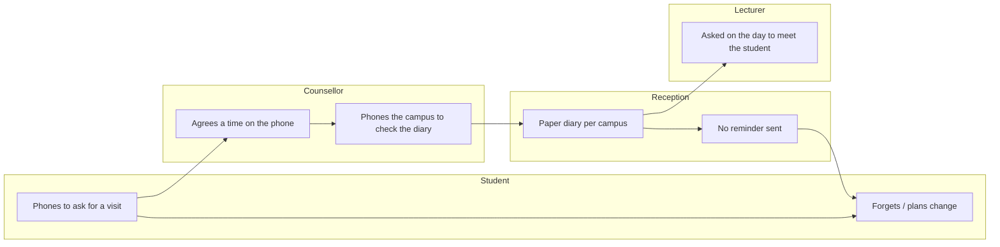

# Exercise 01 — Model answer (abridged)

## Current state

Pain points: double phone calls; diaries at two campuses that don't match; no reminders; lecturers asked at the last minute; no record of who attended, so no follow-up.

## 5 Whys: "students don't turn up"
They forget → no reminder is sent → nobody owns reminders → the diary is on paper, so nothing can send them automatically → visits were never part of any system.

## Future state: starts / stops

| Role | Starts | Stops |
| --- | --- | --- |
| Counsellor | Books in AdmitFlow during the call, sees capacity live | Phoning the campus to check the diary |
| Reception | Marks attended / no-show on a tablet | The paper diary |
| Student | Gets a confirmation and a reminder the day before | — |
| Lecturer | Sees tomorrow's visits each evening | Being pulled in on the day |

## Cost estimate
~120 visits a month; ~35% no-shows (assumption: confirm with reception) = 42 wasted slots, each ~45 minutes of counsellor and lecturer time ≈ 60 hours a month. If reminders halve no-shows and visitors enrol at, say, 30%, that's ~6 extra enrolments a month to validate in a pilot.
