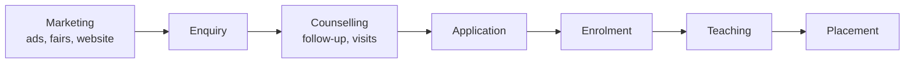

# Lesson 01 — How businesses work (enough to find the value)

**Time:** ~3 hours · **Core**

## Why this matters

Clients don't buy software; they buy outcomes: more students enrolled, fewer hours wasted, less risk. To find where software creates value, you need a working model of how the client's business makes and spends money, and what its leaders are measured on.

## The basic questions

For any client, find out:
1. **Who pays them, and for what?** (Revenue: students pay fees per term)
2. **What does it cost to deliver?** (Teachers, campuses, marketing, admin staff)
3. **What limits growth?** (Seats? Enquiries? Conversion? Reputation?)
4. **What are leaders measured on?** (Enrolments per intake, cost per enrolment, completion rates)
5. **What keeps them awake?** (Competitors, regulation, a bad review, cash flow before the intake)

## Unit economics, for Northbridge

| Measure | How to think about it | Where AdmitFlow helps |
| --- | --- | --- |
| **Revenue per enrolment** | Fee per term × terms (≈ 4,350 for a one-year diploma) | — |
| **Cost per enquiry** | Ad spend ÷ enquiries from ads | Which campaigns produce enrolments (Module 05 report) |
| **Conversion rate** | Enrolments ÷ enquiries | Speed of first contact (Module 07 finding) |
| **Cost per enrolment** | Marketing + admissions cost ÷ enrolments | Fewer wasted ad rupees; less admin time |
| **Contribution margin** | Revenue minus the variable cost of teaching a student | The honest basis for ROI (Lesson 04) |

A useful sentence to be able to say: *"Each extra enrolment is worth roughly 4,350 in fees and perhaps a third of that in contribution, so moving conversion by one percentage point on 9,000 enquiries is worth about…"* You'll build this properly in Exercise 02.

## Value chains and where software fits

Software creates value where a step is **slow, error-prone, invisible or expensive**. At Northbridge in Module 01: enquiries scattered (invisible), follow-ups missed (slow), ad performance unknown (invisible), copying between spreadsheets (expensive).

## Three kinds of value

| Kind | Example | How to measure |
| --- | --- | --- |
| **Revenue** | More enrolments from the same enquiries | Conversion before vs after (with a control if possible) |
| **Cost** | Counsellor hours not spent copying data; ad budget moved from campaigns that don't enrol | Hours × cost; ad spend per enrolment |
| **Risk** | Fewer data-protection incidents; no wrong fees quoted | Incidents, complaints, audit findings |

Leaders weigh these differently. Ms. Rao (director) cares most about enrolments and the board; Ms. Chen (finance) about predictable cost; Mr. Okafor (IT) about risk and workload. **Translate the same project into each person's terms.**

## Read the client's own numbers

Ask for the documents leaders already use: the board report, the budget, last intake's results. They tell you what matters, in the client's own vocabulary, and they're where your impact will eventually be reported.

## Check yourself

For an organization you know (or Northbridge), write: how it makes money, its two biggest costs, the one number its leader is judged on, and three places where software could plausibly move that number. Put a rough value on one of them.

Next: [Lesson 02 — Mapping processes and finding root causes](02-process-mapping.md)
