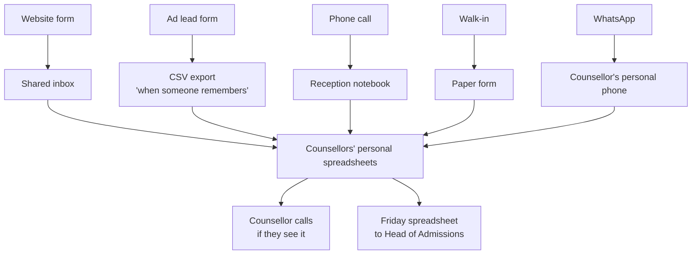

# Lesson 02 — Mapping processes and finding root causes

**Time:** ~3 hours · **Core**

## Current state first

Before designing anything, map how work **actually** happens today, including the workarounds: sticky notes, personal spreadsheets, the WhatsApp group, "ask Priya." Map from observation and interviews, not from the official procedure document.

Northbridge's enquiry process before AdmitFlow:

Mark on the map:
- **Delays** (time between steps): the ad export waits days
- **Hand-offs** (where things get lost): notebook → spreadsheet
- **Duplication**: the same student in three spreadsheets
- **Invisible work**: the Friday report
- **Pain** in people's own words

## Swimlanes

For processes with several roles, draw one lane per role (reception, counsellor, head of admissions, IT). Hand-offs between lanes are where most delays and losses happen.

## Finding root causes

**5 Whys:** keep asking why until you reach something you can change.

> Students enrol elsewhere. *Why?* → Nobody called them back. *Why?* → The counsellor didn't see the enquiry. *Why?* → It was in the ad export nobody downloaded. *Why?* → Downloading is a manual task with no owner. *Why?* → No system brings enquiries together automatically.

**Fishbone (Ishikawa):** list possible causes under headings (People, Process, Tools, Data, Environment) to avoid fixating on one.

Beware of stopping at a person ("Lucía is slow"); keep going to the system that made the outcome likely.

## Future state

Draw the process as it should work, and note **what changes for each role**, including what they **stop** doing:

| Role | Starts | Stops |
| --- | --- | --- |
| Reception | Adds phone and walk-in enquiries in AdmitFlow | The notebook |
| Counsellor | Works from "Due today" in AdmitFlow | Personal spreadsheets |
| Head of Admissions | Uses the team view | The Friday spreadsheet |
| IT | Owns accounts via Google | Password resets |

The "Stops" column is where adoption is won or lost. Module 11's break & fix is a project that forgot it.

## Quantify the pain

For each pain point, estimate frequency × time × cost, or the lost outcome. "Counsellors spend ~2.5 hours a week each copying between spreadsheets" × 6 counsellors = 15 hours a week. Those numbers feed the business case (Lesson 04).

## Check yourself

Do [Exercise 01](../exercises/01-process-map.md): map the current and future state of the **campus visit** process at Northbridge (booking, reminders, attendance, follow-up) from the perspective of three roles, with a starts/stops table.

Next: [Lesson 03 — Discovery and requirements, in depth](03-discovery-and-requirements.md)
