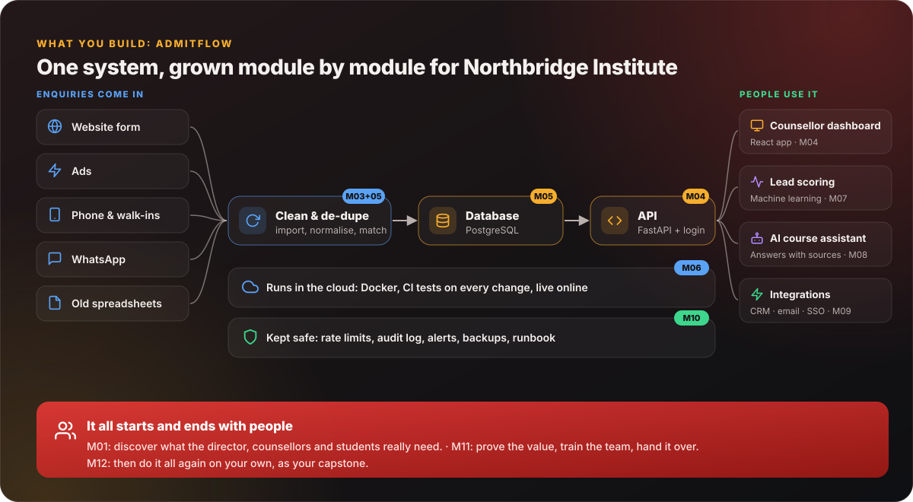

# AdmitFlow

The running project for the whole handbook: an admissions system for a fictional educational institute that grows from a discovery document into a deployed, AI-assisted production system.

- **Client brief:** [BRIEF.md](BRIEF.md). Start here.
- **How it grows module by module:** [ROADMAP §5](../../ROADMAP.md#5-the-running-project-admitflow)



## How it grew, module by module

| Module | Added |
| --- | --- |
| 01 | Discovery pack (documents only) |
| 02 | Sample data + terminal analysis script |
| 03 | Python CLI lead manager with tests |
| 04 | FastAPI backend, React dashboard, login and roles |
| 05 | SQL storage, migrations, ingestion pipeline, admissions matching |
| 06 | Containers, Compose, CI with PostgreSQL, deployment guide |
| 07 | Lead scoring (and the honest finding about response speed) |
| 08 | Course assistant (RAG), evaluation set, follow-up drafts with approval |
| 09 | Webhooks, outbox, CRM sync, Google sign-in, MCP server |
| 10 | Rate limits, redaction, audit log, metrics, alerts, backups, runbook |
| 11 | User guide and handover pack |

The sections below describe each stage, newest first. This folder holds the final state; each module's build page lists the files that module introduced.

## Module 10: hardening and operations

- Rate limits (`/public/*` per IP, login per username), security headers, CSP on the dashboard; log redaction; minimized AI prompts.
- Audit log (`GET /audit`, admins), migration `0004`. Metrics at `/metrics` (set `ADMITFLOW_METRICS_TOKEN`); alert rules in [`deploy/monitoring/alerts.yml`](deploy/monitoring/alerts.yml).
- `admitflow backup --to …` and `admitflow verify-backup …` (SQLite). Operations: [`docs/runbook.md`](docs/runbook.md).

## Module 09: integrations

- Signed website webhook `POST /public/webhooks/website-form`; Google sign-in `POST /auth/google`.
- `admitflow send-approved` (outbox: email/WhatsApp, approved drafts only), `admitflow crm-sync` (idempotent), `admitflow mcp --user <name>` (MCP server, Python 3.10+).
- Install: `pip install -e ".[api,db,integrations,dev]"`. Migration `0003`. Decisions: [ADR-006](docs/adr/006-integrations.md).

## Module 08: course assistant and follow-up drafts

- `admitflow ask "How much is Data Analytics?"` answers from [`data/course_docs`](data/course_docs/fees-2026.md) with citations; `admitflow eval-assistant` runs the [52-case evaluation](data/eval/assistant_eval.jsonl).
- API: `POST /public/assistant/ask` (public), `POST /leads/{id}/drafts`, `GET /drafts`, `POST /drafts/{id}/approve|reject`.
- Engines: offline (default, free, deterministic) or Claude (`ADMITFLOW_LLM=claude`, `pip install -e ".[llm]"`, Python 3.10+). Migration `0002` adds the drafts table.
- Decisions: [ADR-005](docs/adr/005-course-assistant.md).

## Module 07: lead scoring

- `admitflow train-model data/historical_leads.csv --out models/lead_score.joblib` trains on the 2024 intake, tests on 2025, compares with a baseline, and prints enrolment by response time.
- API: `GET /leads/{id}/score` and `GET /leads/priority` (set `ADMITFLOW_MODEL`). Without a model these return 503; everything else works. Install with the `ml` extra.
- Decision and its evidence: [ADR-004](docs/adr/004-lead-scoring.md). New data: [`data/historical_leads.csv`](data/historical_leads.csv).

## Module 06: containers, CI and deployment

- **Run everything locally:** `cp .env.example .env` (set real values), then `docker compose up --build`. Dashboard http://localhost:8080, API http://localhost:8000/docs.
- **Images:** [`Dockerfile`](Dockerfile) (API: multi-stage, non-root, health check) and [`web/Dockerfile`](web/Dockerfile) (static build + nginx).
- **CI:** [`.github/workflows/admitflow-ci.yml`](../../.github/workflows/admitflow-ci.yml): tests on Python 3.9 and 3.12 against JSON, SQLite and real PostgreSQL, frontend build, image build and smoke test.
- **Deploying:** [`deploy/README.md`](deploy/README.md): Cloud Run walkthrough with AWS/Azure equivalents, plus a teaching Terraform example.
- New endpoint `/ready` (readiness: checks storage). `admitflow serve` reads `HOST` and `PORT` from the environment.

## Module 05: SQL database, pipeline and admissions matching

- **SQL storage** (`admitflow/db.py`): set `DATABASE_URL` (e.g. `sqlite:///admitflow.db` or `postgresql+psycopg://…`), run `alembic upgrade head`. The API and CLI switch automatically.
- **Pipeline** (`admitflow/pipeline.py`): `admitflow ingest --website … --ads … --walkins …` (idempotent, audited, reconciled), `admitflow match-admissions data/admissions_export.csv`, `admitflow report`.
- **Migrations:** `migrations/` (Alembic). Install with `pip install -e ".[api,db,dev]"`.
- New sample file: [`data/admissions_export.csv`](data/admissions_export.csv): 25 enrolments from the student information system (22 match a lead; 3 don't, deliberately).

## Module 04: web API and counsellor dashboard

- **API** (`admitflow/api/`): FastAPI with login, roles, leads, notes, follow-ups and stats. Install with `pip install -e ".[api,dev]"`, set `ADMITFLOW_SECRET_KEY`, create users with `admitflow create-user`, run `admitflow serve`, then see http://localhost:8000/docs.
- **Dashboard** (`web/`): React + TypeScript. `cd web && npm install && npm run dev`, then open http://localhost:5173.
- **Decisions:** [`docs/adr/`](docs/adr/001-repository-interface.md).
- Configuration: `ADMITFLOW_STORE` (JSON file), `ADMITFLOW_SECRET_KEY` (required for the API), `ADMITFLOW_CORS_ORIGINS` (default `http://localhost:5173`), `VITE_API_URL` (dashboard → API).

## Module 03: command-line lead manager

A standard-library-only Python tool that imports the three channel exports, normalizes names, phones, emails and courses, deduplicates students, and lets counsellors search and export.

### Install

```bash
cd projects/admitflow
```

```bash
python3 -m venv .venv && source .venv/bin/activate
```

```bash
python -m pip install --upgrade pip
```

```bash
python -m pip install -e ".[dev]"
```

### Use

```bash
admitflow import --website data/leads_sample.csv --ads data/ad_leads.csv --walkins data/walkins.csv
```

```bash
admitflow stats
```

```bash
admitflow search "nguyễn"
```

```bash
admitflow list --source whatsapp --course nursing
```

```bash
admitflow export walkins.csv --source walk-in
```

Leads are stored in `leads.json`, or wherever `ADMITFLOW_STORE` points.

### Deduplication rule

| Match | Result |
| --- | --- |
| Same lead ID | Same record (the file was imported again) |
| Same email | Same person |
| Same phone **and** same name | Same person |
| Same phone only | **Not merged**: families often share a phone |

The earliest enquiry is kept, and every channel the person used is recorded in `sources`.

### Test

```bash
pytest
```

Runs the full suite with coverage (fails below 80%). API tests are skipped automatically if the `api` extras aren't installed. Frontend: `cd web && npm test`.

### Layout

| File | Responsibility |
| --- | --- |
| [`admitflow/models.py`](admitflow/models.py) | `Lead` dataclass |
| [`admitflow/normalize.py`](admitflow/normalize.py) | Pure cleaning functions |
| [`admitflow/importers.py`](admitflow/importers.py) | One reader per export format; reports rejected rows |
| [`admitflow/dedupe.py`](admitflow/dedupe.py) | Merge rule above |
| [`admitflow/store.py`](admitflow/store.py) | JSON store and CSV export |
| [`admitflow/cli.py`](admitflow/cli.py) | Command-line interface |

### Sample data

| File | Rows | Quirks |
| --- | --- | --- |
| [`data/leads_sample.csv`](data/leads_sample.csv) | 120 | Blank lines, inconsistent channel names, `"Last, First"` names |
| [`data/ad_leads.csv`](data/ad_leads.csv) | 60 | Different columns, ISO timestamps, many phone formats, names in many alphabets |
| [`data/walkins.csv`](data/walkins.csv) | 25 | Excel BOM, day-first dates, ALL-CAPS names, phone *or* email in one column |
| [`data/admissions_export.csv`](data/admissions_export.csv) | 25 | Different system: student numbers, `"SURNAME, Given"` names, phones with a leading `0` |

All people, emails and phone numbers are fictional. Phones use the reserved 555-01xx range; emails use `example.*` domains.
