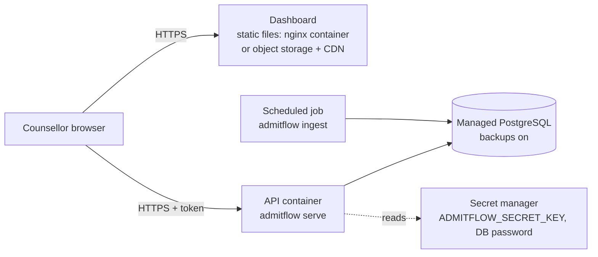

# Deploying AdmitFlow

> Module 06 reference. Commands are written for current CLIs as of late 2026. **Cloud consoles and CLIs change often: check each provider's official docs as you go.** The handbook authors validated the YAML and Python; the Docker and cloud steps were **not executed** while writing (no Docker or cloud account in the writing environment), and CI builds the images on every pull request.

## What gets deployed



| Piece | Local (Compose) | Google Cloud | AWS | Azure |
| --- | --- | --- | --- | --- |
| API container | `api` service | Cloud Run service | App Runner or ECS Fargate | Container Apps |
| Dashboard | `web` service | Cloud Run or Cloud Storage + CDN | S3 + CloudFront | Static Web Apps |
| Database | `db` (postgres:16) | Cloud SQL for PostgreSQL | RDS for PostgreSQL | Azure Database for PostgreSQL |
| Secrets | `.env` file | Secret Manager | Secrets Manager / SSM | Key Vault |
| Migrations | `migrate` service | Cloud Run job, before deploy | ECS task / CodeBuild step | Container Apps job |
| Scheduled ingest | (manual) | Cloud Run job + Cloud Scheduler | EventBridge Scheduler + ECS task | Container Apps job (cron) |
| Images | local build | Artifact Registry | ECR | Azure Container Registry |
| Logs/metrics | `docker compose logs` | Cloud Logging / Monitoring | CloudWatch | Azure Monitor |

## 1. Run everything locally

```bash
cd projects/admitflow
```

```bash
cp .env.example .env
```

Edit `.env` and set real random values, then:

```bash
docker compose up --build
```

Load data and create a user (in another terminal):

```bash
docker compose run --rm -v "$PWD/data:/data:ro" api admitflow ingest --website /data/leads_sample.csv --ads /data/ad_leads.csv --walkins /data/walkins.csv
```

```bash
docker compose run --rm api admitflow create-user priya --full-name "Priya Nair"
```

Open http://localhost:8080.

## 2. Deploy to Google Cloud Run (the walkthrough used in Module 06)

Prerequisites: a Google Cloud project with billing, the `gcloud` CLI, and permission to create resources. **On a client engagement, this happens in the client's project, under their policies.**

Set the project and region (pick a region close to users and allowed by the client's data rules):

```bash
gcloud config set project YOUR_PROJECT_ID
```

```bash
gcloud config set run/region asia-south1
```

Enable the services:

```bash
gcloud services enable run.googleapis.com sqladmin.googleapis.com secretmanager.googleapis.com artifactregistry.googleapis.com
```

Create a container registry and build the image in the cloud (no local Docker needed):

```bash
gcloud artifacts repositories create admitflow --repository-format=docker --location=asia-south1
```

```bash
gcloud builds submit --tag asia-south1-docker.pkg.dev/YOUR_PROJECT_ID/admitflow/api:v1 .
```

Create the database (smallest tier for a pilot; check pricing first):

```bash
gcloud sql instances create admitflow-db --database-version=POSTGRES_16 --tier=db-f1-micro --region=asia-south1 --backup
```

```bash
gcloud sql databases create admitflow --instance=admitflow-db
```

```bash
gcloud sql users create admitflow --instance=admitflow-db --password="$(python3 -c 'import secrets; print(secrets.token_urlsafe(24))')"
```

Store secrets (never as plain environment variables in the console):

```bash
python3 -c 'import secrets; print(secrets.token_urlsafe(48), end="")' | gcloud secrets create admitflow-secret-key --data-file=-
```

Create a `admitflow-database-url` secret the same way, containing
`postgresql+psycopg://admitflow:PASSWORD@/admitflow?host=/cloudsql/YOUR_PROJECT_ID:asia-south1:admitflow-db`.

Run migrations as a one-off job, then deploy the service:

```bash
gcloud run jobs create admitflow-migrate --image asia-south1-docker.pkg.dev/YOUR_PROJECT_ID/admitflow/api:v1 --command alembic --args upgrade,head --set-cloudsql-instances YOUR_PROJECT_ID:asia-south1:admitflow-db --set-secrets DATABASE_URL=admitflow-database-url:latest
```

```bash
gcloud run jobs execute admitflow-migrate --wait
```

```bash
gcloud run deploy admitflow-api --image asia-south1-docker.pkg.dev/YOUR_PROJECT_ID/admitflow/api:v1 --set-cloudsql-instances YOUR_PROJECT_ID:asia-south1:admitflow-db --set-secrets ADMITFLOW_SECRET_KEY=admitflow-secret-key:latest,DATABASE_URL=admitflow-database-url:latest --set-env-vars ADMITFLOW_CORS_ORIGINS=https://YOUR-DASHBOARD-ORIGIN,TZ=Asia/Kolkata --allow-unauthenticated
```

`--allow-unauthenticated` makes the API reachable from browsers. The API still requires a login token for everything except `/health` and `/ready`.

Build the dashboard with the API's URL and deploy it the same way (`web/Dockerfile`, `--build-arg VITE_API_URL=https://admitflow-api-….run.app`), or upload `web/dist/` to a storage bucket behind a CDN.

## 3. Rolling back

Cloud Run keeps every revision:

```bash
gcloud run revisions list --service admitflow-api
```

```bash
gcloud run services update-traffic admitflow-api --to-revisions REVISION_NAME=100
```

Database migrations don't roll back automatically. That's why Module 06 Lesson 07 insists on backward-compatible migrations.

## 4. Infrastructure as Code (stretch)

[`terraform-cloud-run/main.tf`](terraform-cloud-run/main.tf) describes the same setup declaratively: database with backups and no public IP, least-privilege service account, secret, and Cloud Run service with startup and liveness probes. Review it with `terraform plan` before applying anything.

## 5. Before go-live checklist

Use the [deployment guide template](../../../templates/deployment-guide.md). At minimum: backups verified by a test restore, secrets in a secret manager, HTTPS only, CORS limited to the real dashboard origin, budget alert set, a named owner on the client side, and a rollback tested once.
